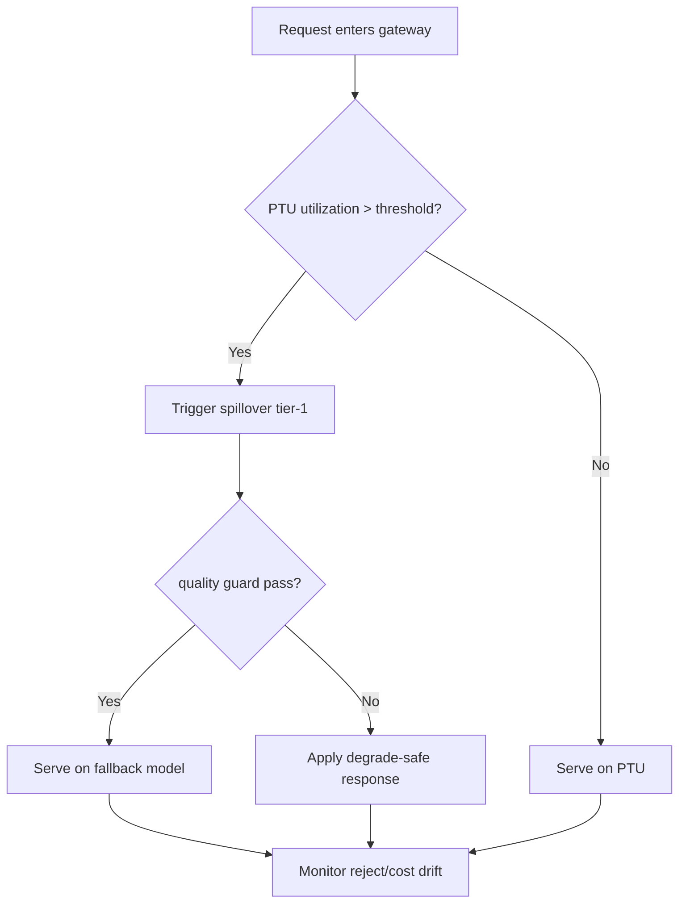
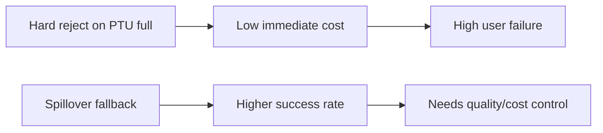
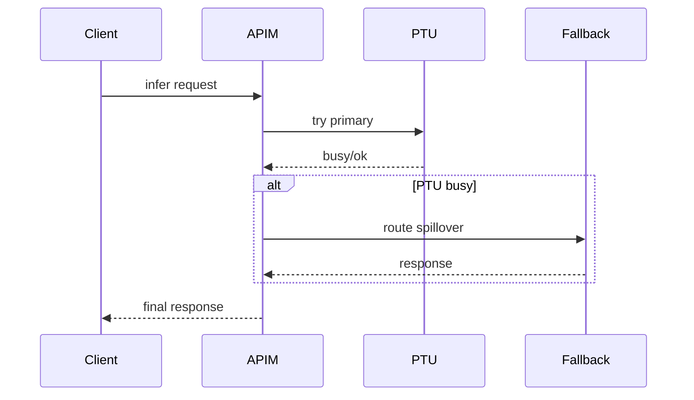

# Agent APIM PTU Spillover Fallback 选型 FAQ（Azure AI Agent Infra）

## 1) 3 分钟结论
- **PTU 容量打满时若无 spillover fallback，会出现集中拒绝与级联重试。**
- **推荐“阈值前移 + 分级回退 + 降质保护”策略。**
- **目标阈值：`ptu_reject <0.6%`、`fallback_p95 <280ms`、`quality_drop <2%`。**

## 2) Q1 / Q2 / Q3
- **为何会雪崩？**：PTU 拥塞后请求同时重试打满后备通道。
- **为何不能全量直切后备？**：成本抬升且质量波动增大。
- **最小闭环？**：预警阈值、分级导流、质量守门。

### Q1：何时触发 spillover？
PTU 利用率接近上限并持续超阈值。

### Q2：何时回切 PTU？
拥塞解除且延迟恢复稳定。

### Q3：如何衡量收益？
比较拒绝率下降与成本增量。

## 3) Mermaid 图
### 3.1 决策树

### 3.2 路径对比

### 3.3 时序

## 4) 决策矩阵
| 维度 | PTU 满即拒绝 | spillover 回退（推荐） |
|---|---:|---:|
| 成功率 | 低 | 高 |
| 成本可控性 | 高 | 中高 |
| 运维复杂度（1-10） | 3 | 8 |
| 用户体验 | 低 | 高 |
| 质量稳定性 | 中 | 中高 |

## 5) 定量算例与 7-Card 洞察
- 收益：`RejectGain = BaselineReject - FallbackReject`
- 成本增量：`CostLift = FallbackCost - PTUCost`
- 示例（`synthetic_assumed`）：
  - `BaselineReject=2.8%, FallbackReject=0.5%`
  - `RejectGain=2.3%`
  - `PTUCost=$0.010/session, FallbackCost=$0.012/session`
  - `CostLift=$0.002/session`
- 证据：
  - `workshops/azure-agent-infra/evidence/cycle-1487-benchmark.json`
  - `workshops/azure-agent-infra/evidence/cycle-1487-sources.json`
- 标签：`official/synthetic_assumed/not_measured`。

## 6) 生产核验 Checklist
- [ ] PTU 预警阈值与导流策略版本化
- [ ] fallback 质量守门与压降规则可审计
- [ ] reject/cost 漂移告警已配置
- [ ] 回切 PTU 条件自动校验通过
- [ ] FAQ/7-Card 来源标签完整
