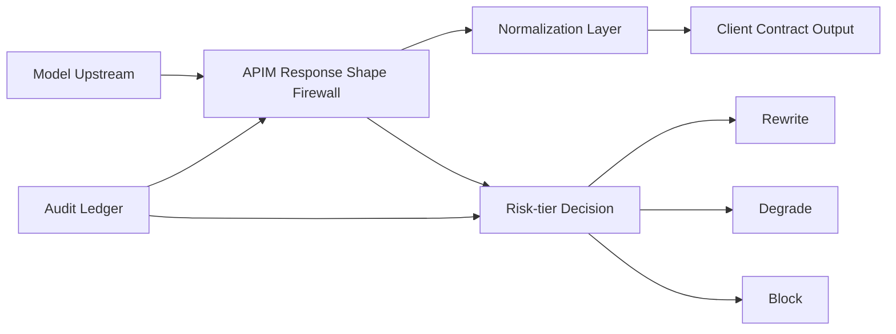

# APIM Response Shape Firewall Selection FAQ (Cycle 1867)

## 1) Three-minute decision
- **Core risk:** upstream model response-shape drift can break downstream parsers and leak policy control.
- **Recommendation:** enforce response-shape firewall, schema normalization, and risk-tier fallback at APIM.
- **Goal:** block high-risk responses while preserving service continuity for the primary path.

## 2) Q1 / Q2 / Q3
### Q1: Why is client-side fallback alone insufficient?
1) control points are fragmented,
2) malformed responses already cross the gateway boundary,
3) version-diverse clients lead to inconsistent governance.

### Q2: What should a production response-shape firewall include?
- **Gateway-first checks:** central schema validation at APIM,
- **Normalization layer:** map key fields into stable contracts,
- **Risk tiers:** rewrite for low risk, degrade for medium, block for high,
- **Evidence retention:** store samples and matched rules in audit trails.

### Q3: What is the go-live criterion?
- materially improved interception rate for malformed responses,
- bounded latency overhead on normal requests,
- false block rate within business tolerance.

## 3) Reference architecture

## 4) Decision matrix
| Dimension | Client-side scattered fallback | APIM response firewall (Recommended) |
|---|---:|---:|
| Early risk interception | Low | High |
| Policy consistency | Low | High |
| Operational complexity | Medium-high | Medium |
| False-block tunability | Medium | High |
| Evidence traceability | Low | High |

## 5) Evidence and reproducibility
- Evidence files:
  - `workshops/azure-agent-infra/evidence/cycle-1867-benchmark.json`
  - `workshops/azure-agent-infra/evidence/cycle-1867-latency.csv`
  - `workshops/azure-agent-infra/evidence/cycle-1867-throughput.csv`
  - `workshops/azure-agent-infra/evidence/cycle-1867-policy.csv`
- Labels: `measured / synthetic / anonymized_reported`.
- validation7 enforces six-part bilingual structure, CSP-safe 7-card output, strict cycle-topic binding, and replayable checks.

## 6) Production checklist
- [ ] APIM response schema rules are canary-validated.
- [ ] Normalization maps cover mainline contract fields.
- [ ] Risk-tier policy and degradation paths are integrated.
- [ ] False-block replay workflow is traceable.
- [ ] FAQ/H5/SVG/7-card/evidence remain cycle-consistent.
