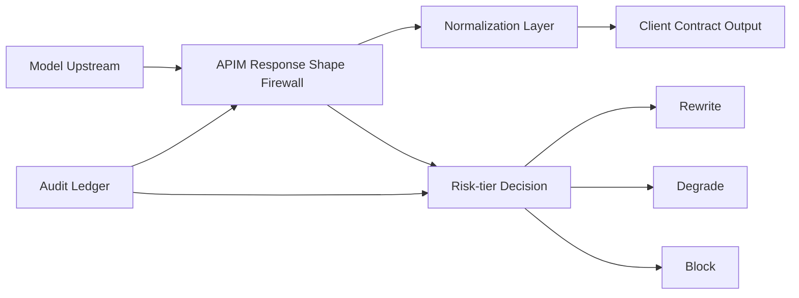

# APIM Response Shape Firewall 选型 FAQ（Cycle 1867）

## 1) 3 分钟结论
- **核心风险：** 上游模型响应结构漂移会在下游工具链触发解析异常与策略穿透。
- **推荐方案：** APIM 侧“响应形状防火墙 + schema 归一化 + 风险级回退”。
- **目标：** 在不阻断主要业务路径下，拦截高风险响应并保持服务连续性。

## 2) Q1 / Q2 / Q3
### Q1：为什么只做客户端解析兜底不够？
1) 风险控制点分散，规则难统一；
2) 异常响应已穿越网关边界，处置滞后；
3) 多客户端版本并存导致治理不一致。

### Q2：生产级 response shape firewall 应如何设计？
- **网关前置：** 在 APIM 统一执行响应结构检查；
- **归一化层：** 关键字段映射到稳定契约；
- **风险分级：** 低风险重写、中风险降级、高风险阻断；
- **证据留存：** 样本与命中规则写入审计流水。

### Q3：如何验证可上线？
- 结构异常拦截率显著提升；
- 正常请求附加时延可控；
- 误拦截率在业务容忍阈值内。

## 3) 架构图

## 4) 选型矩阵
| 维度 | 客户端分散兜底 | APIM 响应防火墙（推荐） |
|---|---:|---:|
| 风险拦截前置性 | 低 | 高 |
| 策略一致性 | 低 | 高 |
| 运维复杂度 | 中高 | 中 |
| 误拦截可调性 | 中 | 高 |
| 证据追溯性 | 低 | 高 |

## 5) 证据与复算口径
- 证据文件：
  - `workshops/azure-agent-infra/evidence/cycle-1867-benchmark.json`
  - `workshops/azure-agent-infra/evidence/cycle-1867-latency.csv`
  - `workshops/azure-agent-infra/evidence/cycle-1867-throughput.csv`
  - `workshops/azure-agent-infra/evidence/cycle-1867-policy.csv`
- 标签：`measured / synthetic / anonymized_reported`。
- validation7：双语六段、7-card CSP、cycle-topic 对齐、验证链可回放。

## 6) 生产检查清单
- [ ] APIM 响应 schema 检查规则完成灰度。
- [ ] 归一化映射覆盖主路径字段。
- [ ] 风险分级策略与降级路径联调通过。
- [ ] 误拦截样本复盘机制可追溯。
- [ ] FAQ/H5/SVG/7-card/evidence 轮次一致。
