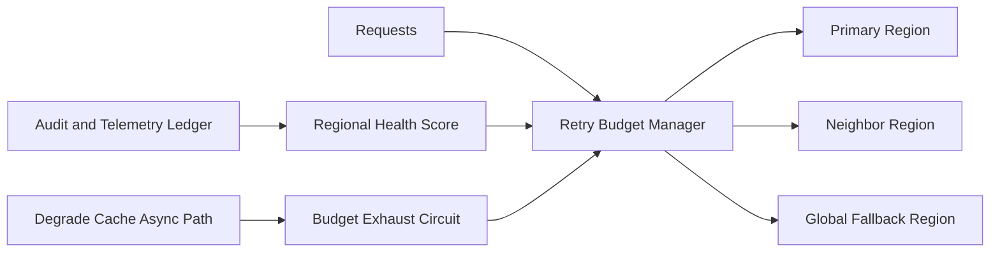

# APIM Retry Budget Cross-region Selection FAQ (Cycle 1887)

## 1) Three-minute decision
- **Core issue:** during regional faults, unbounded retries amplify traffic globally and destabilize recovery paths.
- **Recommendation:** combine retry-budget pools, region-tier fallback, and budget-exhaust circuit controls.
- **Goal:** control retry amplification while preserving critical-request success during cross-region failures.

## 2) Q1 / Q2 / Q3
### Q1: Why are fixed retry counts unreliable cross-region?
1) regional health differs in real time,
2) fixed retries create useless loops in unhealthy regions,
3) critical and non-critical traffic cannot be protected differently.

### Q2: How should production retry budgets be designed?
- **Budget pools:** allocate retry budgets by tenant/business priority,
- **Region tiers:** prefer local recovery, then neighbor region, then global fallback,
- **Budget circuit:** degrade to cache/async path when budget is exhausted,
- **Feedback convergence:** replenish/debit budgets from regional health scoring.

### Q3: What is the go-live bar?
- retry amplification remains bounded during failure windows,
- critical-request success stays within target band,
- budget-exhaust degrade behavior is stable and predictable.

## 3) Reference architecture

## 4) Decision matrix
| Dimension | Fixed retry policy | Cross-region retry budget (Recommended) |
|---|---:|---:|
| Retry amplification control | Low | High |
| Critical-path protection | Medium | High |
| Cross-region recovery stability | Medium | High |
| Implementation complexity | Low | Medium |
| Behavior predictability | Low | High |

## 5) Evidence and reproducibility
- Evidence files:
  - `workshops/azure-agent-infra/evidence/cycle-1887-benchmark.json`
  - `workshops/azure-agent-infra/evidence/cycle-1887-latency.csv`
  - `workshops/azure-agent-infra/evidence/cycle-1887-throughput.csv`
  - `workshops/azure-agent-infra/evidence/cycle-1887-policy.csv`
- Labels: `measured / synthetic / anonymized_reported`.
- validation7 enforces six-part structure, CSP-safe 7-card output, strict cycle-topic alignment, and replayable checks.

## 6) Production checklist
- [ ] Priority-based cross-region retry budgets are configured.
- [ ] Region-tier fallback paths are integrated.
- [ ] Budget-exhaust circuit and degrade channel pass stress tests.
- [ ] Regional-health feedback tuning remains stable.
- [ ] FAQ/H5/SVG/7-card/evidence remain cycle-consistent.
