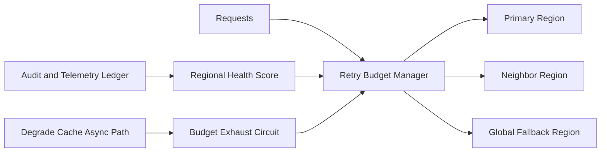

# APIM Retry Budget Cross-region 选型 FAQ（Cycle 1887）

## 1) 3 分钟结论
- **核心问题：** 跨区域故障时无预算约束的重试会放大全局流量并拖垮恢复链路。
- **推荐方案：** “重试预算池 + 区域分级回退 + 预算耗尽熔断”组合治理。
- **目标：** 在跨区故障窗口内控制重试放大系数并保障关键请求成功率。

## 2) Q1 / Q2 / Q3
### Q1：为什么固定重试次数在跨区场景不可靠？
1) 不同区域健康状态差异大；
2) 固定重试会在故障区形成无效流量回环；
3) 关键与非关键请求无法差异化保障。

### Q2：生产级 retry budget 如何设计？
- **预算池模型：** 按租户/业务等级分配跨区重试预算；
- **区域分级：** 优先同区恢复，其次邻近区，最后全局回退；
- **预算熔断：** 预算耗尽后降级到缓存/异步通道；
- **反馈收敛：** 依据区域健康分动态补充与扣减预算。

### Q3：上线判据是什么？
- 故障窗口重试放大倍数受控；
- 关键请求成功率维持目标区间；
- 预算耗尽降级路径稳定可预测。

## 3) 架构图

## 4) 选型矩阵
| 维度 | 固定重试策略 | 跨区预算重试（推荐） |
|---|---:|---:|
| 重试放大控制 | 低 | 高 |
| 关键请求保障 | 中 | 高 |
| 跨区恢复稳定性 | 中 | 高 |
| 实施复杂度 | 低 | 中 |
| 行为可预测性 | 低 | 高 |

## 5) 证据与复算口径
- 证据文件：
  - `workshops/azure-agent-infra/evidence/cycle-1887-benchmark.json`
  - `workshops/azure-agent-infra/evidence/cycle-1887-latency.csv`
  - `workshops/azure-agent-infra/evidence/cycle-1887-throughput.csv`
  - `workshops/azure-agent-infra/evidence/cycle-1887-policy.csv`
- 标签：`measured / synthetic / anonymized_reported`。
- validation7：六段结构、7-card CSP、cycle-topic 对齐、验证链可回放。

## 6) 生产检查清单
- [ ] 跨区重试预算池按等级配置完成。
- [ ] 区域分级回退路径联调通过。
- [ ] 预算耗尽熔断与降级通道压测通过。
- [ ] 区域健康反馈调优机制稳定运行。
- [ ] FAQ/H5/SVG/7-card/evidence 轮次一致。
