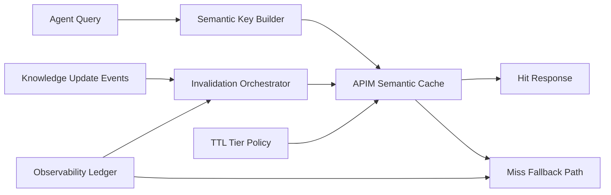

# APIM Semantic Cache Consistency Selection FAQ (Cycle 1871)

## 1) Three-minute decision
- **Core tradeoff:** semantic caching improves throughput and cost, but weak consistency control increases stale-answer risk.
- **Recommendation:** combine semantic-key versioning, tiered TTLs, and event-driven invalidation.
- **Goal:** preserve hit-rate gains while keeping stale-output risk under strict thresholds.

## 2) Q1 / Q2 / Q3
### Q1: Why is fixed TTL alone insufficient?
1) update frequencies differ across knowledge domains,
2) high-value paths need faster invalidation,
3) fixed TTL cannot react to bursty update events.

### Q2: What should production semantic-cache consistency include?
- **Key versioning:** embed model/policy/knowledge snapshot versions in semantic keys,
- **Tiered TTL:** short TTL for volatile domains, longer TTL for stable domains,
- **Event invalidation:** targeted invalidation on source updates,
- **Origin protection:** throttle and queue fallback traffic during miss storms.

### Q3: What is the go-live bar?
- hit-rate and throughput improvements meet targets,
- stale-output rate remains below threshold,
- recovery window after invalidation events stays bounded.

## 3) Reference architecture

## 4) Decision matrix
| Dimension | Fixed-TTL cache | Versioned + event invalidation (Recommended) |
|---|---:|---:|
| Hit efficiency | Medium | High |
| Consistency controllability | Low | High |
| Stale-risk suppression | Low | High |
| Implementation complexity | Low | Medium |
| Observability | Medium | High |

## 5) Evidence and reproducibility
- Evidence files:
  - `workshops/azure-agent-infra/evidence/cycle-1871-benchmark.json`
  - `workshops/azure-agent-infra/evidence/cycle-1871-latency.csv`
  - `workshops/azure-agent-infra/evidence/cycle-1871-throughput.csv`
  - `workshops/azure-agent-infra/evidence/cycle-1871-policy.csv`
- Labels: `measured / synthetic / anonymized_reported`.
- validation7 enforces six-part structure, CSP-safe 7-card output, strict cycle-topic alignment, and replayable checks.

## 6) Production checklist
- [ ] Semantic key versions are bound to policy/model snapshots.
- [ ] Tiered TTL rules cover core domains.
- [ ] Update-event invalidation path passes drills.
- [ ] Miss-storm origin protection thresholds are validated.
- [ ] FAQ/H5/SVG/7-card/evidence remain cycle-consistent.
