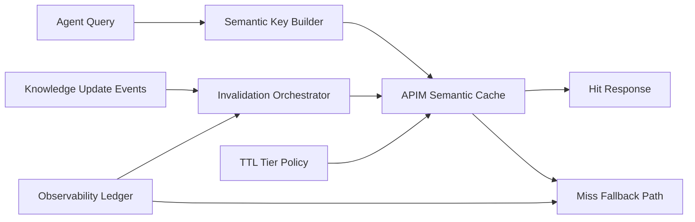

# APIM Semantic Cache Consistency 选型 FAQ（Cycle 1871）

## 1) 3 分钟结论
- **核心矛盾：** 语义缓存提升吞吐与成本效率，但一致性失控会放大陈旧答案风险。
- **推荐方案：** “语义键版本化 + TTL 分层 + 失效事件驱动刷新”组合。
- **目标：** 在保障命中率的同时，将陈旧输出风险压制在可控阈值。

## 2) Q1 / Q2 / Q3
### Q1：为什么只靠固定 TTL 不够？
1) 不同知识域更新频率差异大；
2) 高价值场景需要更快失效响应；
3) 固定 TTL 无法处理突发变更事件。

### Q2：生产级 semantic cache consistency 怎么设计？
- **键版本化：** 语义键携带模型/策略/知识快照版本；
- **TTL 分层：** 高频变更短 TTL，稳定域长 TTL；
- **事件失效：** 知识源更新触发定向失效；
- **回源保护：** miss 风暴时启用回源限流与队列。

### Q3：上线判据是什么？
- 命中率与吞吐提升达到目标；
- 陈旧输出率不超过阈值；
- 失效事件后恢复窗口可控。

## 3) 架构图

## 4) 选型矩阵
| 维度 | 固定 TTL 缓存 | 版本化+事件失效（推荐） |
|---|---:|---:|
| 命中效率 | 中 | 高 |
| 一致性可控性 | 低 | 高 |
| 陈旧风险抑制 | 低 | 高 |
| 实施复杂度 | 低 | 中 |
| 可观测性 | 中 | 高 |

## 5) 证据与复算口径
- 证据文件：
  - `workshops/azure-agent-infra/evidence/cycle-1871-benchmark.json`
  - `workshops/azure-agent-infra/evidence/cycle-1871-latency.csv`
  - `workshops/azure-agent-infra/evidence/cycle-1871-throughput.csv`
  - `workshops/azure-agent-infra/evidence/cycle-1871-policy.csv`
- 标签：`measured / synthetic / anonymized_reported`。
- validation7：六段结构、7-card CSP、cycle-topic 对齐、验证链可回放。

## 6) 生产检查清单
- [ ] 语义键版本字段与策略版本绑定完成。
- [ ] TTL 分层规则覆盖核心知识域。
- [ ] 知识更新事件失效链路演练通过。
- [ ] miss 风暴回源保护阈值验证通过。
- [ ] FAQ/H5/SVG/7-card/evidence 轮次一致。
