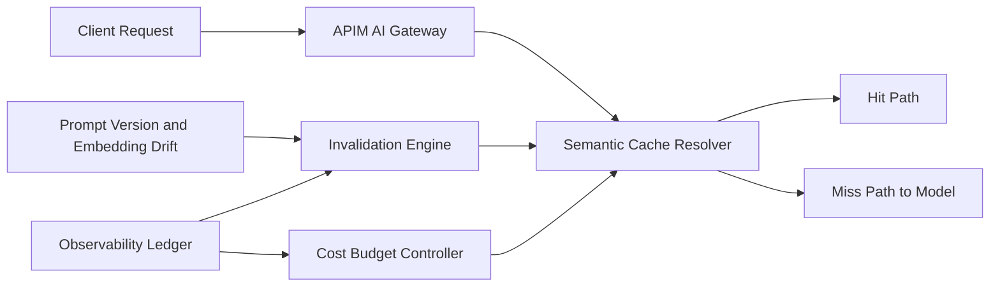

# APIM Semantic Cache Eviction Selection FAQ (Cycle 1842)

## 1) Three-minute decision
- **Core tradeoff:** higher semantic-cache hit rate reduces latency and spend, but weak eviction policy risks stale responses and cross-tenant contamination.
- **Recommendation:** tenant-isolated namespaces, dual-factor TTL/hotness eviction, and semantic-drift invalidation.
- **Goal:** increase gateway throughput and reduce model spend while preserving response correctness.

## 2) Q1 / Q2 / Q3
### Q1: Why is fixed TTL-only eviction insufficient?
1) popular intents get recomputed before TTL expiry,
2) semantic changes still hit stale entries within TTL,
3) multi-tenant fairness is hard to maintain with one-dimensional expiry.

### Q2: What production-grade semantic-cache eviction model should be used?
- **Isolation domain:** cache namespaces by tenant/workspace,
- **Dual-factor eviction:** combine hotness score and remaining TTL,
- **Drift invalidation:** force invalidate on prompt-version or embedding drift thresholds,
- **Budget coupling:** tighten cache admission/retention when model-cost pressure rises.

### Q3: How do we validate faster and accurate behavior?
- higher hit rate with bounded false-hit ratio,
- lower P95 response latency,
- lower token/request and total cost with tenant-attributable evidence.

## 3) Reference architecture

## 4) Decision matrix
| Dimension | Fixed TTL eviction | Dual-factor + drift invalidation (Recommended) |
|---|---:|---:|
| Hit-rate stability | Medium | High |
| Correctness guarantee | Low | High |
| Cost control | Medium | High |
| Implementation complexity | Low | Medium |
| Multi-tenant fairness | Low | High |

## 5) Evidence and reproducibility
- Evidence files:
  - `workshops/azure-agent-infra/evidence/cycle-1842-benchmark.json`
  - `workshops/azure-agent-infra/evidence/cycle-1842-latency.csv`
  - `workshops/azure-agent-infra/evidence/cycle-1842-throughput.csv`
  - `workshops/azure-agent-infra/evidence/cycle-1842-policy.csv`
- Labels: `measured / synthetic / anonymized_reported`.
- validation7 enforces bilingual six-part structure, CSP self-contained 7-card output, strict cycle-evidence alignment, and replayability.

## 6) Production checklist
- [ ] Tenant-isolated cache namespaces are active.
- [ ] TTL/hotness eviction parameters are tunable and canary-ready.
- [ ] Drift-threshold invalidation is replay-validated.
- [ ] Cost-budget coupling with cache gates is enforced.
- [ ] FAQ/H5/SVG/7-card align with cycle evidence.
