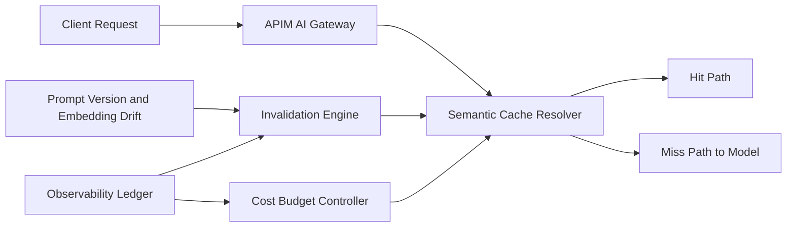

# APIM Semantic Cache 逐出策略选型 FAQ（Cycle 1842）

## 1) 3 分钟结论
- **核心矛盾：** 语义缓存命中率越高越省时省费，但缓存逐出策略不当会引入陈旧响应与跨租户污染风险。
- **推荐：** 租户隔离命名空间 + TTL/热度双因子逐出 + 语义漂移阈值失效。
- **目标：** 在保障正确性的前提下提升网关吞吐并降低模型调用成本。

## 2) Q1 / Q2 / Q3
### Q1：为什么只按固定 TTL 逐出会失真？
1) 热点问题在 TTL 到期前反复重算，浪费 token；
2) 业务语义变化时，旧缓存在 TTL 内仍被错误命中；
3) 多租户场景下难以平衡公平性与命中率。

### Q2：生产级语义缓存逐出模型怎么设计？
- **隔离域：** 按 tenant/workspace 分 cache namespace；
- **双因子逐出：** 结合热度分与剩余 TTL 计算逐出优先级；
- **漂移失效：** prompt 模板版本或 embedding 漂移超阈值强制失效；
- **预算联动：** 当模型成本突增时动态收紧缓存准入与保留策略。

### Q3：如何验证“快且准”？
- 命中率提升且错误命中率受控；
- P95 响应延迟下降；
- 单请求 token 成本与总费用下降并可按租户解释。

## 3) 架构图

## 4) 选型矩阵
| 维度 | 固定 TTL 逐出 | 双因子 + 漂移失效（推荐） |
|---|---:|---:|
| 命中率稳定性 | 中 | 高 |
| 正确性保障 | 低 | 高 |
| 成本控制 | 中 | 高 |
| 实施复杂度 | 低 | 中 |
| 多租户公平性 | 低 | 高 |

## 5) 证据与复算口径
- 证据文件：
  - `workshops/azure-agent-infra/evidence/cycle-1842-benchmark.json`
  - `workshops/azure-agent-infra/evidence/cycle-1842-latency.csv`
  - `workshops/azure-agent-infra/evidence/cycle-1842-throughput.csv`
  - `workshops/azure-agent-infra/evidence/cycle-1842-policy.csv`
- 标签：`measured / synthetic / anonymized_reported`。
- validation7：双语六段结构、7-card CSP 自包含、轮次与 evidence 一致、可回放链路通过。

## 6) 生产检查清单
- [ ] 缓存 namespace 完成租户隔离。
- [ ] TTL/热度逐出策略参数化并可灰度。
- [ ] 漂移阈值失效机制可回放验证。
- [ ] 成本预算联动缓存门禁生效。
- [ ] FAQ/H5/SVG/7-card 与 evidence 轮次一致。
