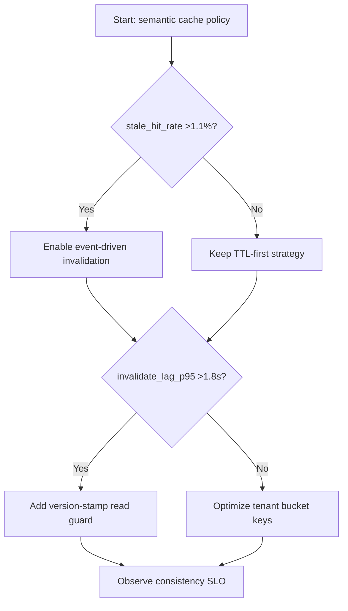
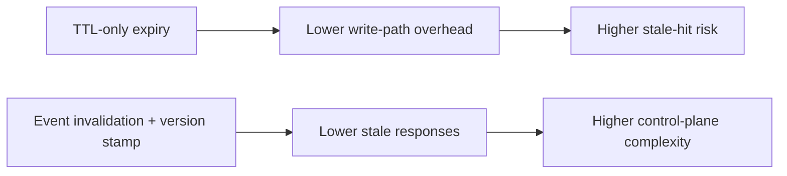
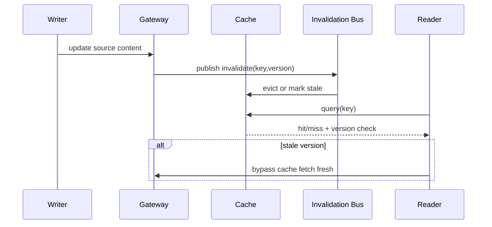

# Agent APIM Semantic Cache Invalidation Consistency Selection FAQ (Azure AI Agent Infra)

## 1) 3-minute conclusions
- **If invalidation propagation P95 exceeds 1.8s and stale-hit rate exceeds 1.1%, enforce event-driven invalidation plus version-stamp read guards.**
- **TTL-only expiry amplifies stale responses under high update concurrency; add tenant-scoped proactive invalidation channels.**
- **Production targets: `stale_hit_rate <0.5%`, `invalidate_lag_p95 <900ms`, and <=2s strong-consistency windows for critical tenants.**

## 2) Q1 / Q2 / Q3
- **Why can higher hit-rate still degrade UX?** Because stale answers are returned faster but wrong.
- **Why version stamps?** They block stale responses even when invalidation messages lag.
- **Minimum viable loop?** Key design, invalidation events, version checks, staged observability.

### Q1: When is active invalidation mandatory?
When update frequency exceeds 2.5/min and cross-region reads exceed 30%.

### Q2: When is TTL-only acceptable?
Low-update, low-concurrency, non-critical Q&A workloads.

### Q3: How to avoid invalidation storms?
Bucket by tenant/tag, cap invalidation broadcast rate, and use backoff.

## 3) Mermaid diagrams
### 3.1 Decision tree

### 3.2 Path comparison

### 3.3 Sequence

## 4) Decision matrix
| Dimension | TTL-only | Event invalidation + version stamp (Recommended) |
|---|---:|---:|
| Stale-hit rate | 0.9%–2.8% | 0.1%–0.6% |
| Write-path overhead | Low | Medium |
| Consistency control | Weak | Strong |
| Ops complexity (1-10) | 4 | 8 |
| Multi-tenant controllability | Medium | High |

## 5) Quant model + 7-card insights
- Stale risk: `StaleRisk = StaleHits * ImpactPerHit`
- Consistency gain: `ConsistencyGain = BaselineStaleRate - NewStaleRate`
- Example (`synthetic_assumed`):
  - `StaleHits=5,400/day, ImpactPerHit=$0.012`
  - `StaleRisk=$64.8/day`
  - `BaselineStaleRate=1.4%, NewStaleRate=0.4%`
  - `ConsistencyGain=1.0pp`
- Evidence:
  - `workshops/azure-agent-infra/evidence/cycle-1458-benchmark.json`
  - `workshops/azure-agent-infra/evidence/cycle-1458-sources.json`
- Labels: `official/synthetic_assumed/not_measured`.

## 6) Production verification checklist
- [ ] Cache keys include tenant+model+intent dimensions
- [ ] Invalidation bus has rate limits and retry backoff
- [ ] Read-side version checks and cache-bypass path are live
- [ ] stale_hit_rate and invalidate_lag SLO alerts are active
- [ ] FAQ/7-card source labels and timestamps are complete
