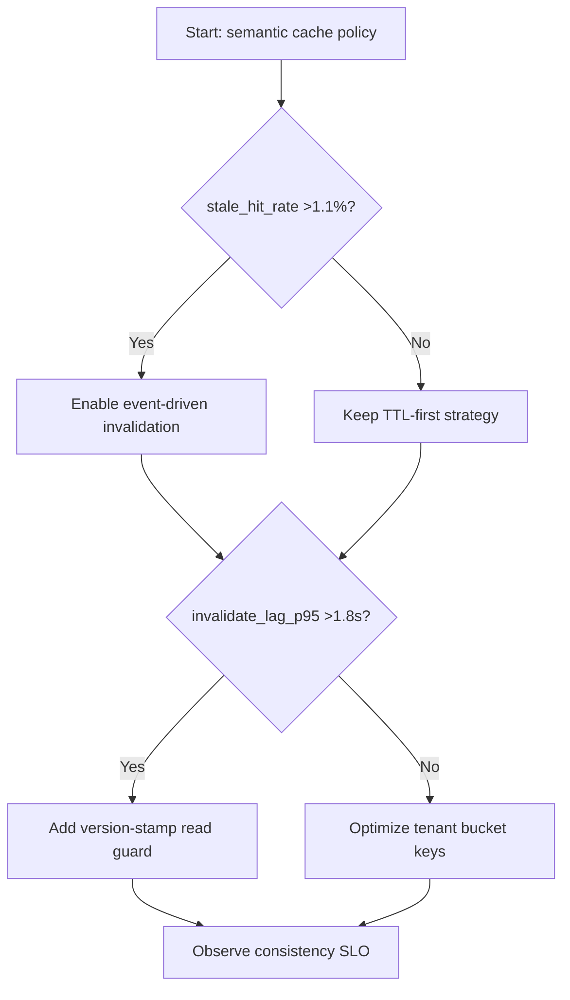
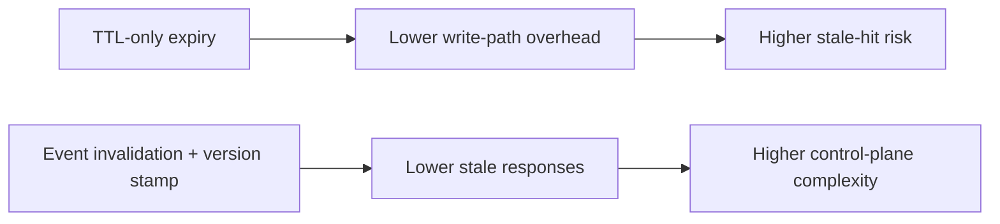
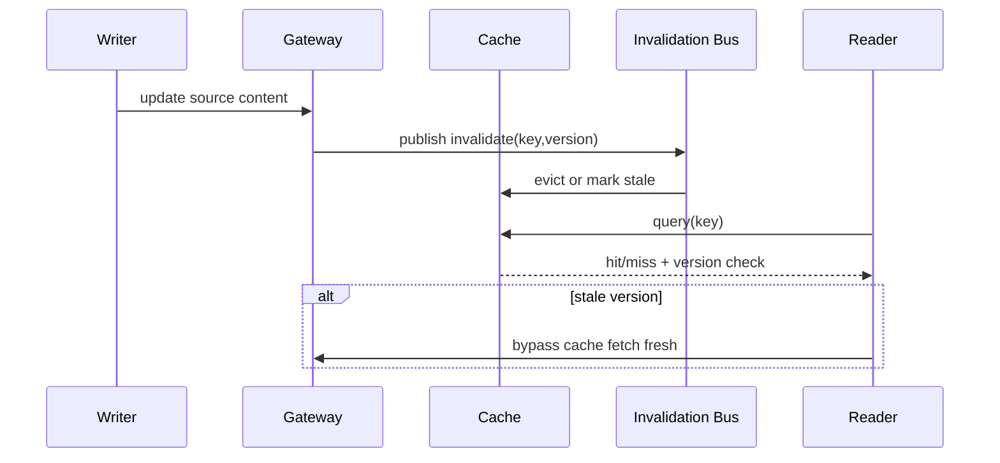

# Agent APIM Semantic Cache Invalidation Consistency 选型 FAQ（Azure AI Agent Infra）

## 1) 3 分钟结论
- **当语义缓存失效传播 P95 >1.8s 且陈旧命中率 >1.1% 时，必须启用“事件驱动失效 + 版本戳二次校验”。**
- **仅依赖 TTL 过期会在高并发写入下放大陈旧响应；应叠加租户级主动失效通道。**
- **生产阈值：`stale_hit_rate <0.5%`、`invalidate_lag_p95 <900ms`、关键租户强一致命中窗口 <=2s。**

## 2) Q1 / Q2 / Q3
- **为什么缓存命中率高却体验更差？**：命中了旧答案，导致语义偏差和回滚成本上升。
- **为什么要版本戳？**：在失效消息延迟时，仍能在读取侧阻断旧数据返回。
- **最小闭环？**：键设计、失效事件、版本戳校验、灰度观测。

### Q1：何时必须启用主动失效事件？
当更新频率 >2.5 次/分钟且跨区读流量占比 >30%。

### Q2：何时 TTL-only 还能接受？
低更新、低并发、非关键问答场景。

### Q3：如何控制失效风暴？
按租户和标签分桶，限制每秒失效广播上限并启用退避。

## 3) Mermaid 图
### 3.1 决策树

### 3.2 路径对比

### 3.3 时序

## 4) 决策矩阵
| 维度 | TTL-only | 事件失效+版本戳（推荐） |
|---|---:|---:|
| 陈旧命中率 | 0.9%–2.8% | 0.1%–0.6% |
| 写路径开销 | 低 | 中 |
| 一致性控制 | 弱 | 强 |
| 运维复杂度（1-10） | 4 | 8 |
| 多租户可控性 | 中 | 高 |

## 5) 定量算例与 7-Card 洞察
- 陈旧风险：`StaleRisk = StaleHits * ImpactPerHit`
- 一致性收益：`ConsistencyGain = BaselineStaleRate - NewStaleRate`
- 示例（`synthetic_assumed`）：
  - `StaleHits=5,400/day, ImpactPerHit=$0.012`
  - `StaleRisk=$64.8/day`
  - `BaselineStaleRate=1.4%, NewStaleRate=0.4%`
  - `ConsistencyGain=1.0pp`
- 证据：
  - `workshops/azure-agent-infra/evidence/cycle-1458-benchmark.json`
  - `workshops/azure-agent-infra/evidence/cycle-1458-sources.json`
- 标签：`official/synthetic_assumed/not_measured`。

## 6) 生产核验 Checklist
- [ ] 缓存键包含 tenant+model+intent 维度
- [ ] 失效事件总线具备限流与重试退避
- [ ] 读取侧版本戳校验与旁路取新逻辑已上线
- [ ] stale_hit_rate 与 invalidate_lag SLO 告警生效
- [ ] FAQ/7-Card 来源标签与时间戳完整
