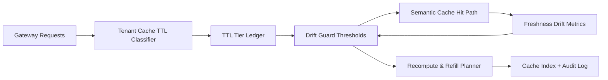

# APIM Semantic Cache Tenant TTL Drift Selection FAQ (Cycle 1912)

## 1) Three-minute decision
- **Core issue:** in multi-tenant semantic cache workloads, one global TTL causes freshness drift and unstable hit quality across tenants.
- **Recommendation:** apply tenant-tier TTL bands, drift-guard thresholds, and recompute-refill recovery.
- **Goal:** reduce cross-tenant cache contamination and stabilize latency/cost without stale-hit amplification.

## 2) Q1 / Q2 / Q3
### Q1: Why govern tenant TTL drift?
1) global TTL ignores tenant-specific update cadence,
2) apparent hit-rate gains can hide freshness regression,
3) without mismatch recovery, stale cache errors persist.

### Q2: How should production design work?
- **TTL tiering:** assign short/medium/long TTL by tenant tier and scenario,
- **Drift guard:** monitor freshness delta and trigger guards when thresholds exceed,
- **Recompute refill:** recompute mismatch keys and refresh cache index,
- **Audit trail:** persist guard triggers, refill counts, and tenant blast radius.

### Q3: What is the go-live bar?
- freshness variance across tenants narrows,
- hit-rate gain does not trade off freshness,
- guard/refill actions are replayable and explainable.

## 3) Reference architecture

## 4) Decision matrix
| Dimension | Global unified TTL | Tenant TTL Drift Governance (Recommended) |
|---|---:|---:|
| Freshness stability | Low | High |
| Cross-tenant isolation | Low | High |
| Cache cost control | Medium | High |
| Audit explainability | Medium | High |
| Implementation complexity | Low | Medium |

## 5) Evidence and reproducibility
- Evidence files:
  - `workshops/azure-agent-infra/evidence/cycle-1912-benchmark.json`
  - `workshops/azure-agent-infra/evidence/cycle-1912-latency.csv`
  - `workshops/azure-agent-infra/evidence/cycle-1912-throughput.csv`
  - `workshops/azure-agent-infra/evidence/cycle-1912-cost.csv`
- Labels: `measured / synthetic / anonymized_reported`.
- Repro method: fixed sampling window, fixed TTL tier rules, fixed cost model.

## 6) Production checklist
- [ ] Tenant TTL bands align with SLA tiering.
- [ ] Drift-guard thresholds pass historical replay.
- [ ] Recompute/refill includes cooldown and rollback switches.
- [ ] Guard/refill traces are tenant-auditable.
- [ ] FAQ/H5/SVG/7-card/evidence remain cycle-topic consistent.
