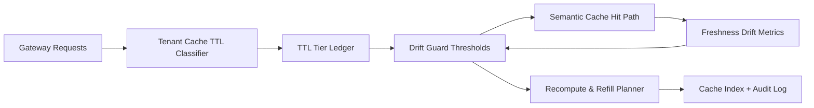

# APIM Semantic Cache Tenant TTL Drift 选型 FAQ（Cycle 1912）

## 1) 3 分钟结论
- **核心问题：** 多租户 semantic cache 在高并发下若使用统一 TTL，容易出现租户间命中漂移与过期抖动。
- **推荐方案：** “租户分层 TTL 档位 + 漂移守卫阈值 + 失配回填重算”三层治理。
- **目标：** 降低跨租户缓存污染与 TTL 漂移导致的命中抖动，稳定网关延迟与成本。

## 2) Q1 / Q2 / Q3
### Q1：为什么需要 tenant TTL drift 治理？
1) 全局 TTL 无法反映租户流量与语义更新频率差异；
2) 漂移会让命中率看似上升但语义陈旧风险增加；
3) 失配回收缺失会导致错误缓存持续放大。

### Q2：生产级如何设计？
- **TTL 分层：** 按租户等级与场景定义短/中/长档 TTL；
- **漂移守卫：** 监控命中新鲜度差值，超阈值触发 guard；
- **重算回填：** 对失配 key 执行重算并更新缓存索引；
- **审计链路：** 记录 guard 触发、回填次数与租户影响面。

### Q3：上线判据是什么？
- 租户间命中新鲜度偏差显著收敛；
- 缓存命中率提升不以语义漂移为代价；
- guard 与回填动作可回放、可解释、可复算。

## 3) 架构图

## 4) 选型矩阵
| 维度 | 全局统一 TTL | Tenant TTL Drift Governance（推荐） |
|---|---:|---:|
| 命中新鲜度稳定性 | 低 | 高 |
| 跨租户隔离性 | 低 | 高 |
| 缓存成本可控性 | 中 | 高 |
| 审计可解释性 | 中 | 高 |
| 实施复杂度 | 低 | 中 |

## 5) 证据与复算口径
- 证据文件：
  - `workshops/azure-agent-infra/evidence/cycle-1912-benchmark.json`
  - `workshops/azure-agent-infra/evidence/cycle-1912-latency.csv`
  - `workshops/azure-agent-infra/evidence/cycle-1912-throughput.csv`
  - `workshops/azure-agent-infra/evidence/cycle-1912-cost.csv`
- 标签：`measured / synthetic / anonymized_reported`。
- 口径：固定采样窗口、固定 TTL 档位规则、固定成本模型，支持重复复算。

## 6) 生产检查清单
- [ ] 租户 TTL 档位与业务 SLA 对齐。
- [ ] drift guard 阈值通过历史流量回放验证。
- [ ] recompute/refill 具备冷却与回滚开关。
- [ ] guard 与回填轨迹可按租户审计。
- [ ] FAQ/H5/SVG/7-card/evidence 的 cycle/topic 一致。
