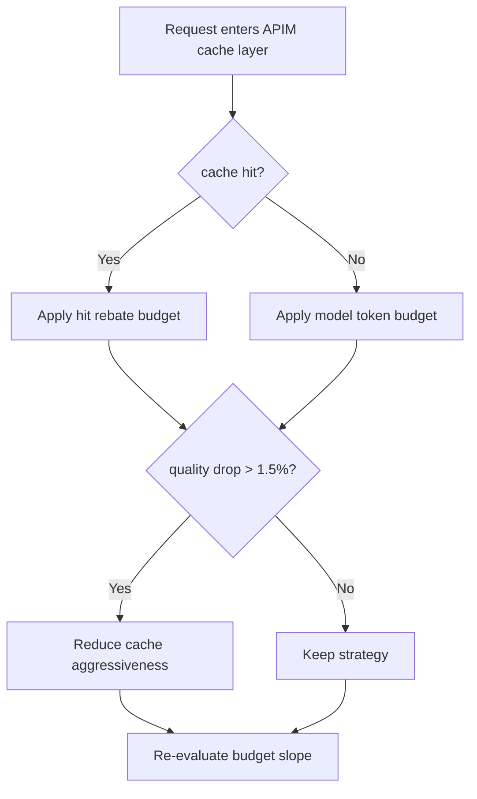
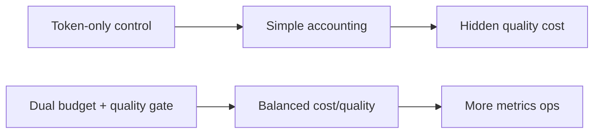
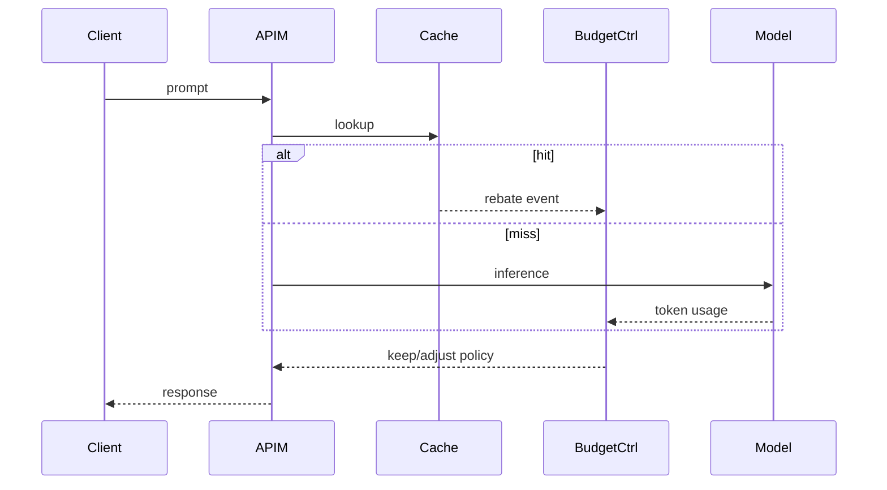

# Agent APIM Semantic Cache Token Budget Selection FAQ (Azure AI Agent Infra)

## 1) 3-minute conclusions
- **If APIM semantic cache is excluded from token budgeting, high-hit scenarios can hide true serving cost.**
- **Use hit rebate budget + miss hard budget + quality floor gates.**
- **Targets: `token_cost_p95 < baseline*0.72`, `quality_drop <1.5%`, `budget_overrun=0`.**

## 2) Q1 / Q2 / Q3
- **Why overruns happen?** Cache-hit and model-call accounting diverge.
- **Why not model-token-only control?** It ignores quality degradation cost on cache-heavy paths.
- **Minimum loop?** Dual ledger, hit rebate, quality guard.

### Q1: When to apply throttling?
When budget burn exceeds threshold and quality declines.

### Q2: When to restore strategy?
After budget stabilizes and quality checks pass consistently.

### Q3: How to measure gain?
Compare token spend, hit rate, and quality shift.

## 3) Mermaid diagrams
### 3.1 Decision tree

### 3.2 Path comparison

### 3.3 Sequence

## 4) Decision matrix
| Dimension | Token-only control | Dual budget + quality gate (Recommended) |
|---|---:|---:|
| Cost transparency | Medium | High |
| Quality stability | Medium | High |
| Ops complexity (1-10) | 4 | 8 |
| Overrun risk | Medium | Low |
| Scalability | Medium | High |

## 5) Quant model + 7-card insights
- Cost gain: `CostGain = BaselineTokenCost - GuardedTokenCost`
- Quality shift: `QualityDrop = BaselineScore - GuardedScore`
- Example (`synthetic_assumed`):
  - `BaselineTokenCost=$0.012/session, GuardedTokenCost=$0.0083/session`
  - `CostGain=$0.0037/session`
  - `BaselineScore=0.934, GuardedScore=0.923`
  - `QualityDrop=1.18%`
- Evidence:
  - `workshops/azure-agent-infra/evidence/cycle-1482-benchmark.json`
  - `workshops/azure-agent-infra/evidence/cycle-1482-sources.json`
- Labels: `official/synthetic_assumed/not_measured`.

## 6) Production verification checklist
- [ ] Hit/miss dual-ledger accounting is consistent
- [ ] Quality gate thresholds and throttles are versioned
- [ ] Overrun alerts and rollback automation work
- [ ] Cost/quality dashboards are traceable
- [ ] FAQ/7-card source labels are complete
