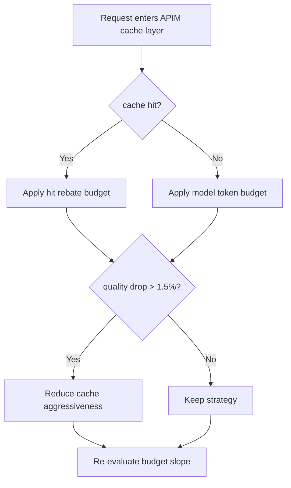
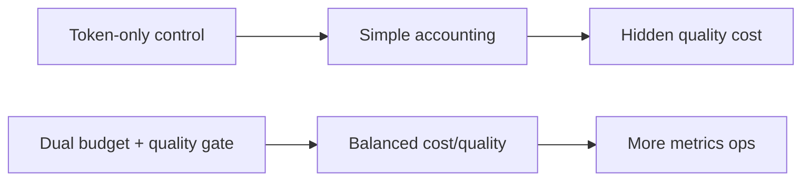
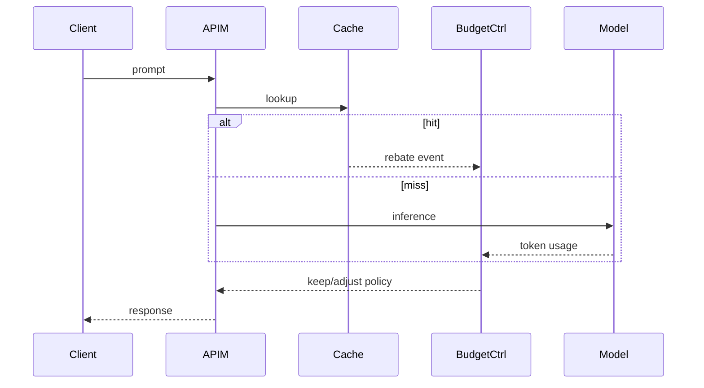

# Agent APIM Semantic Cache Token Budget 选型 FAQ（Azure AI Agent Infra）

## 1) 3 分钟结论
- **APIM 语义缓存若不纳入 token 预算，会在高命中场景掩盖真实成本。**
- **推荐“命中回收预算 + 未命中硬预算 + 质量下限门控”模型。**
- **目标阈值：`token_cost_p95 < baseline*0.72`、`quality_drop <1.5%`、`budget_overrun=0`。**

## 2) Q1 / Q2 / Q3
- **为何会超预算？**：缓存命中与模型调用混合计费口径不一致。
- **为何不能只控模型 token？**：会忽略缓存路径的质量退化成本。
- **最小闭环？**：双预算账本、命中回收、质量守门。

### Q1：何时触发压降？
预算消耗曲线超阈值且质量回落。

### Q2：何时恢复策略？
预算回稳并连续通过质量检查。

### Q3：收益怎么衡量？
对比 token 成本、命中率与质量变化。

## 3) Mermaid 图
### 3.1 决策树

### 3.2 路径对比

### 3.3 时序

## 4) 决策矩阵
| 维度 | 仅 token 控制 | 双预算+质量门控（推荐） |
|---|---:|---:|
| 成本透明性 | 中 | 高 |
| 质量稳定性 | 中 | 高 |
| 运维复杂度（1-10） | 4 | 8 |
| 超预算风险 | 中 | 低 |
| 可扩展性 | 中 | 高 |

## 5) 定量算例与 7-Card 洞察
- 成本收益：`CostGain = BaselineTokenCost - GuardedTokenCost`
- 质量变化：`QualityDrop = BaselineScore - GuardedScore`
- 示例（`synthetic_assumed`）：
  - `BaselineTokenCost=$0.012/session, GuardedTokenCost=$0.0083/session`
  - `CostGain=$0.0037/session`
  - `BaselineScore=0.934, GuardedScore=0.923`
  - `QualityDrop=1.18%`
- 证据：
  - `workshops/azure-agent-infra/evidence/cycle-1482-benchmark.json`
  - `workshops/azure-agent-infra/evidence/cycle-1482-sources.json`
- 标签：`official/synthetic_assumed/not_measured`。

## 6) 生产核验 Checklist
- [ ] hit/miss 双预算账本口径一致
- [ ] 质量门控阈值与压降策略版本化
- [ ] 超预算自动化告警与回滚可用
- [ ] 成本与质量看板可追溯
- [ ] FAQ/7-Card 来源标签完整
