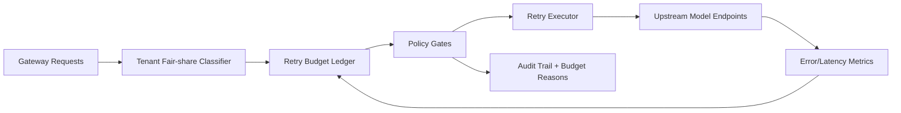

# APIM Tenant Fairshare Retry Budget Selection FAQ (Cycle 1909)

## 1) Three-minute decision
- **Core issue:** under upstream turbulence, a single global retry queue lets high-frequency tenants consume retries and starve critical lower-volume tenants.
- **Recommendation:** apply tenant fair-share allocation, tiered retry budgets, and cooldown-based refill after circuit events.
- **Goal:** suppress retry amplification while preserving critical-tenant availability and stable gateway throughput.

## 2) Q1 / Q2 / Q3
### Q1: Why use tenant fair-share retry budgets?
1) a global pool allows noisy tenants to consume retry capacity,
2) jitter amplifies 429/5xx retry storms,
3) without tenant ledgers, disputes cannot be replayed or explained.

### Q2: How should production design look?
- **Share layer:** assign base retry quotas by tenant tier,
- **Budget layer:** debit retry tokens by error class and time window,
- **Governance layer:** trip circuit + cooldown on overrun, then refill,
- **Audit layer:** persist all debit/deny/refill events for replay.

### Q3: What is the go-live bar?
- lower cross-tenant retry amplification,
- critical-tenant success rate and p95 latency stay within budget,
- every budget denial can be explained and replayed.

## 3) Reference architecture

## 4) Decision matrix
| Dimension | Global retry budget | Tenant Fairshare Retry Budget (Recommended) |
|---|---:|---:|
| Cross-tenant fairness | Low | High |
| Retry storm suppression | Medium | High |
| Critical tenant protection | Low | High |
| Operational explainability | Medium | High |
| Implementation complexity | Low | Medium |

## 5) Evidence and reproducibility
- Evidence files:
  - `workshops/azure-agent-infra/evidence/cycle-1909-benchmark.json`
  - `workshops/azure-agent-infra/evidence/cycle-1909-latency.csv`
  - `workshops/azure-agent-infra/evidence/cycle-1909-throughput.csv`
  - `workshops/azure-agent-infra/evidence/cycle-1909-cost.csv`
- Labels: `measured / synthetic / anonymized_reported`.
- Repro method: fixed sampling window, fixed policy gates, fixed cost formula.

## 6) Production checklist
- [ ] Tenant share policy aligned with business tiers.
- [ ] Retry budget debits validated with historical replay.
- [ ] Circuit/cooldown/refill transitions include rollback switches.
- [ ] Denial reasons are tenant-auditable and queryable.
- [ ] FAQ/H5/SVG/7-card/evidence remain cycle-consistent.
