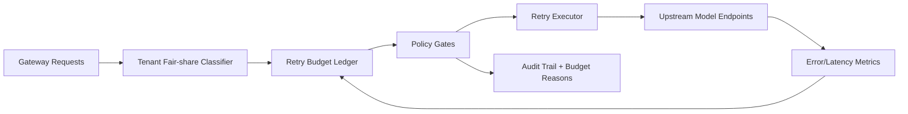

# APIM Tenant Fairshare Retry Budget 选型 FAQ（Cycle 1909）

## 1) 3 分钟结论
- **核心问题：** 多租户网关遇到上游波动时，若各租户共享统一重试队列，容易出现“高频租户挤占预算、低频关键租户被饿死”。
- **推荐方案：** “租户公平份额 + 分级重试预算 + 熔断后冷却回填”三段式治理。
- **目标：** 将雪崩重试放大率压低，同时保持关键租户可用性与网关吞吐稳定。

## 2) Q1 / Q2 / Q3
### Q1：为什么需要 tenant fair-share retry budget？
1) 单一全局预算会让高频租户吞噬重试窗口；
2) 流量抖动时会放大 429/5xx 重试风暴；
3) 缺少份额账本会导致跨租户争议难以解释与回放。

### Q2：生产级怎么落地？
- **份额层：** 先按租户等级分配基础重试配额；
- **预算层：** 按错误类型与时间窗动态扣减重试 token；
- **治理层：** 命中上限后执行熔断+冷却，冷却期结束再回填；
- **审计层：** 全量记录预算扣减、拒绝原因与恢复轨迹。

### Q3：上线判据是什么？
- 跨租户重试放大率稳定下降；
- 关键租户成功率与 P95 延迟保持在预算阈值内；
- 预算拒绝事件可被逐条解释并可回放复算。

## 3) 架构图

## 4) 选型矩阵
| 维度 | 全局统一重试预算 | Tenant Fairshare Retry Budget（推荐） |
|---|---:|---:|
| 跨租户公平性 | 低 | 高 |
| 重试风暴抑制 | 中 | 高 |
| 关键租户保护 | 低 | 高 |
| 运维可解释性 | 中 | 高 |
| 实施复杂度 | 低 | 中 |

## 5) 证据与复算口径
- 证据文件：
  - `workshops/azure-agent-infra/evidence/cycle-1909-benchmark.json`
  - `workshops/azure-agent-infra/evidence/cycle-1909-latency.csv`
  - `workshops/azure-agent-infra/evidence/cycle-1909-throughput.csv`
  - `workshops/azure-agent-infra/evidence/cycle-1909-cost.csv`
- 标签：`measured / synthetic / anonymized_reported`。
- 口径：固定采样窗口、固定策略门禁、固定成本公式，支持复跑对账。

## 6) 生产检查清单
- [ ] 租户份额策略与业务分级已对齐。
- [ ] 重试预算扣减规则通过历史流量回放。
- [ ] 熔断/冷却/回填切换具备回滚开关。
- [ ] 拒绝原因日志可审计、可聚合、可追踪到租户。
- [ ] FAQ/H5/SVG/7-card/evidence 的 cycle/topic 一致。
