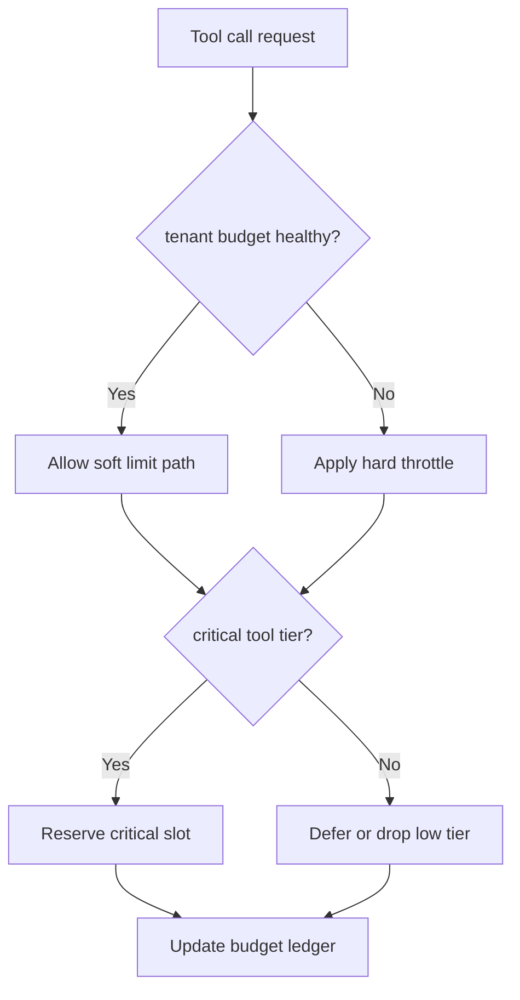
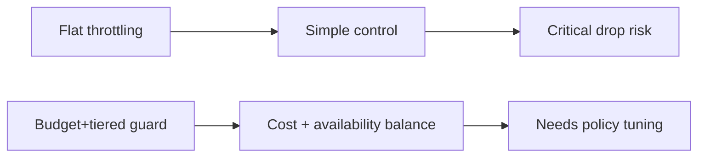
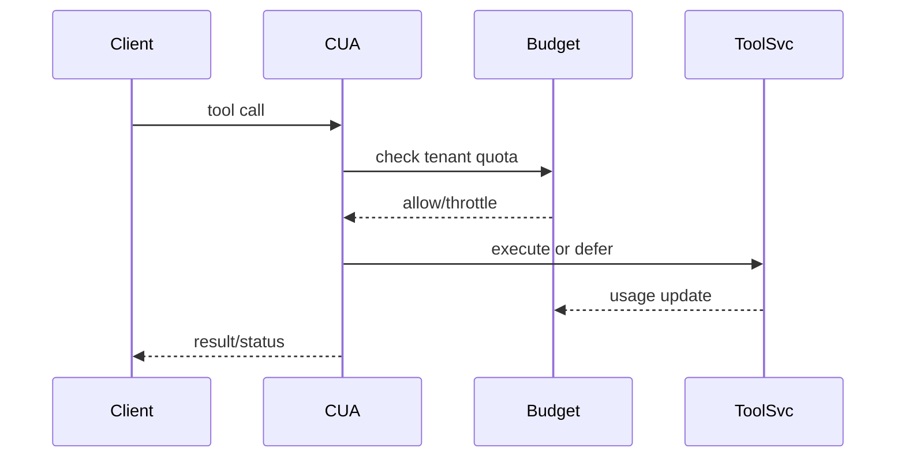

# Agent APIM Tenant Jitter Window 选型 FAQ（Azure AI Agent Infra）

## 1) 3 分钟结论
- **Session 工具调用若无预算护栏，会在高峰时导致网关成本失控与队列阻塞。**
- **推荐“租户预算上限 + 工具优先级分层 + 软硬限流”策略。**
- **目标阈值：`tool_budget_overrun=0`、`queue_p95 <320ms`、`critical_tool_drop <0.2%`。**

## 2) Q1 / Q2 / Q3
- **为何超支？**：工具调用在重试与并发放大后超出预估。
- **为何不能一刀切限流？**：关键工具会被误伤，业务降级明显。
- **最小闭环？**：预算分层、优先级保留、超限回退。

### Q1：何时进入硬限流？
预算耗尽预测达到阈值并持续。

### Q2：何时恢复软限流？
预算回落到安全区且队列恢复。

### Q3：如何衡量收益？
比较超支率、关键调用可用率与排队延迟。

## 3) Mermaid 图
### 3.1 决策树

### 3.2 路径对比

### 3.3 时序

## 4) 决策矩阵
| 维度 | 平面限流 | 预算+分层（推荐） |
|---|---:|---:|
| 成本控制 | 中 | 高 |
| 关键可用性 | 中 | 高 |
| 运维复杂度（1-10） | 4 | 8 |
| 排队稳定性 | 中 | 高 |
| 可扩展性 | 中 | 高 |

## 5) 定量算例与 7-Card 洞察
- 预算超支率：`Overrun = OverBudgetCalls / TotalCalls`
- 关键收益：`CriticalGain = BaselineCriticalDrop - GuardedCriticalDrop`
- 示例（`synthetic_assumed`）：
  - `OverBudgetCalls=0, TotalCalls=128,000`
  - `Overrun=0`
  - `BaselineCriticalDrop=0.9%, GuardedCriticalDrop=0.14%`
  - `CriticalGain=0.76%`
- 证据：
  - `workshops/azure-agent-infra/evidence/cycle-1489-benchmark.json`
  - `workshops/azure-agent-infra/evidence/cycle-1489-sources.json`
- 标签：`official/synthetic_assumed/not_measured`。

## 6) 生产核验 Checklist
- [ ] 工具调用预算账本可审计
- [ ] 关键工具保留槽位策略生效
- [ ] 软硬限流切换阈值有回放
- [ ] 排队延迟与超支率联动告警
- [ ] FAQ/7-Card 来源标签完整
