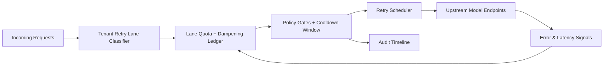

# APIM Tenant Retry Storm Dampening Lane Selection FAQ (Cycle 1910)

## 1) Three-minute decision
- **Core issue:** under upstream throttling or jitter, retry traffic can cascade across tenants and crowd out healthy traffic.
- **Recommendation:** combine tenant lane limits, retry dampening coefficients, and cooldown-window refill.
- **Goal:** constrain retry-blast radius while preserving critical-tenant success and cluster throughput.

## 2) Q1 / Q2 / Q3
### Q1: Why add retry storm dampening lanes?
1) one global retry pool turns local faults into global congestion,
2) high-frequency tenants consume retry budgets first,
3) missing dampening controls causes fast degradation and slow recovery.

### Q2: How should production design work?
- **Lane layer:** split retries by tenant tier and error class,
- **Dampening layer:** enforce backoff caps, jitter factor, and window decay,
- **Refill layer:** freeze overrun tenants in cooldown, refill by priority after window,
- **Audit layer:** persist dampening trigger, denial reason, and recovery trail.

### Q3: What is the go-live bar?
- retry amplification stays down and within threshold,
- critical-tenant success and p95 latency remain stable,
- every dampening and refill action is replayable and explainable.

## 3) Reference architecture

## 4) Decision matrix
| Dimension | Unified retry pool | Retry Storm Dampening Lane (Recommended) |
|---|---:|---:|
| Storm blast suppression | Low | High |
| Cross-tenant fairness | Low | High |
| Critical tenant continuity | Medium | High |
| Audit explainability | Medium | High |
| Implementation complexity | Low | Medium |

## 5) Evidence and reproducibility
- Evidence files:
  - `workshops/azure-agent-infra/evidence/cycle-1910-benchmark.json`
  - `workshops/azure-agent-infra/evidence/cycle-1910-latency.csv`
  - `workshops/azure-agent-infra/evidence/cycle-1910-throughput.csv`
  - `workshops/azure-agent-infra/evidence/cycle-1910-cost.csv`
- Labels: `measured / synthetic / anonymized_reported`.
- Repro method: fixed sampling window, fixed policy gates, fixed cost model.

## 6) Production checklist
- [ ] Tenant lane policy aligns with SLA tiering.
- [ ] Dampening parameters pass historical jitter replay.
- [ ] Cooldown and refill thresholds include one-click rollback.
- [ ] Dampening/deny reasons are tenant-auditable.
- [ ] FAQ/H5/SVG/7-card/evidence remain cycle-topic consistent.
