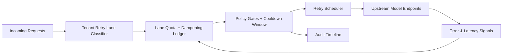

# APIM Tenant Retry Storm Dampening Lane 选型 FAQ（Cycle 1910）

## 1) 3 分钟结论
- **核心问题：** 多租户网关在上游限流或瞬时抖动时，重试流量会形成连锁放大，挤压正常请求。
- **推荐方案：** “租户分道限流 + 重试阻尼系数 + 冷却窗口回填”三层治理。
- **目标：** 控制重试风暴扩散半径，同时保持关键租户成功率和总体吞吐稳定。

## 2) Q1 / Q2 / Q3
### Q1：为什么需要 retry storm dampening lane？
1) 统一重试池会把局部故障扩散成全局拥塞；
2) 高频租户会吞噬重试额度，导致关键低频租户被放大伤害；
3) 缺少阻尼参数会让指数回退失真，形成“慢恢复、快恶化”。

### Q2：生产级如何设计？
- **分道层：** 按租户等级和错误类型切分重试车道；
- **阻尼层：** 叠加退避上限、抖动因子与窗口衰减系数；
- **回填层：** 冷却期内冻结超限租户，窗口结束按优先级回填；
- **审计层：** 记录每次阻尼触发、拒绝原因与恢复轨迹。

### Q3：上线判据是什么？
- 重试放大倍率连续下降并稳定在阈值内；
- 关键租户成功率与 P95 延迟无明显退化；
- 阻尼触发与回填行为可回放、可解释、可复算。

## 3) 架构图

## 4) 选型矩阵
| 维度 | 统一重试池 | Retry Storm Dampening Lane（推荐） |
|---|---:|---:|
| 风暴扩散抑制 | 低 | 高 |
| 跨租户公平性 | 低 | 高 |
| 关键租户连续性 | 中 | 高 |
| 审计可解释性 | 中 | 高 |
| 实施复杂度 | 低 | 中 |

## 5) 证据与复算口径
- 证据文件：
  - `workshops/azure-agent-infra/evidence/cycle-1910-benchmark.json`
  - `workshops/azure-agent-infra/evidence/cycle-1910-latency.csv`
  - `workshops/azure-agent-infra/evidence/cycle-1910-throughput.csv`
  - `workshops/azure-agent-infra/evidence/cycle-1910-cost.csv`
- 标签：`measured / synthetic / anonymized_reported`。
- 口径：固定采样窗口、固定门禁规则、固定成本模型，支持重复执行复算。

## 6) 生产检查清单
- [ ] 租户分道规则与业务 SLA 分级一致。
- [ ] 阻尼参数通过历史抖动流量回放验证。
- [ ] 冷却窗口与回填阈值具备一键回滚。
- [ ] 阻尼触发与拒绝原因可按租户审计。
- [ ] FAQ/H5/SVG/7-card/evidence 的 cycle/topic 全链路一致。
