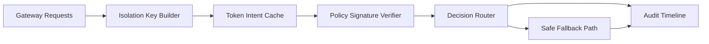

# APIM Token Intent Cache Safety Selection FAQ (Cycle 1895)

## 1) Three-minute decision
- **Core issue:** in multi-tenant AI gateways, reusing token-intent cache entries without safety boundaries can cause cross-tenant contamination and false hits.
- **Recommendation:** enforce tenant-isolated keys, policy-signature versioning, and secure fallback invalidation.
- **Goal:** preserve cache gains while protecting decision integrity and compliance isolation.

## 2) Q1 / Q2 / Q3
### Q1: Why does token-intent cache introduce production risk?
1) similar prompts can produce cross-tenant collisions,
2) policy-version drift can reuse stale decisions,
3) cache miss fallback can amplify latency under load.

### Q2: How should production cache safety be designed?
- **Isolation keys:** include tenant, policy, model, and region in cache keying,
- **Signature versions:** bind intent features to policy-pack signatures,
- **Secure invalidation:** route high-risk hits through forced re-evaluation,
- **Audit tracing:** log hit/fallback/reject events end-to-end.

### Q3: What is the go-live bar?
- higher hit rate with false-hit rate under threshold,
- zero or explainable cross-tenant contamination incidents,
- stable fallback latency within budget.

## 3) Reference architecture

## 4) Decision matrix
| Dimension | Generic shared cache | Cache Safety Model (Recommended) |
|---|---:|---:|
| Hit correctness | Medium | High |
| Tenant isolation | Low | High |
| Compliance auditability | Medium | High |
| Implementation complexity | Low | Medium |
| Performance stability | Medium | High |

## 5) Evidence and reproducibility
- Evidence files:
  - `workshops/azure-agent-infra/evidence/cycle-1895-benchmark.json`
  - `workshops/azure-agent-infra/evidence/cycle-1895-latency.csv`
  - `workshops/azure-agent-infra/evidence/cycle-1895-throughput.csv`
  - `workshops/azure-agent-infra/evidence/cycle-1895-policy.csv`
- Labels: `measured / synthetic / anonymized_reported`.
- Validation chain: six-part FAQ, CSP, cycle/topic binding, simulator checks.

## 6) Production checklist
- [ ] Cache keys include tenant/policy/model/region tuple.
- [ ] Policy signature versions are verifiable on cache hits.
- [ ] High-risk hits force fallback re-evaluation.
- [ ] Audit timeline explains all hit and rollback decisions.
- [ ] FAQ/H5/SVG/7-card/evidence stay cycle-consistent.
