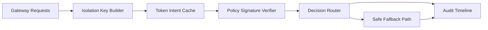

# APIM Token Intent Cache Safety 选型 FAQ（Cycle 1895）

## 1) 3 分钟结论
- **核心问题：** 多租户 AI Gateway 若复用 token-intent cache 缓存结果，缺少安全边界会产生跨租户污染与误命中风险。
- **推荐方案：** “租户隔离键 + 策略签名版本 + 安全失效回退”三层缓存安全模型。
- **目标：** 在维持缓存收益的同时，确保决策正确性与合规隔离。

## 2) Q1 / Q2 / Q3
### Q1：为什么 token-intent cache 在生产中有安全风险？
1) 相似 prompt 可能跨租户命中；
2) 策略版本漂移会导致旧决策复用；
3) 缓存击穿时回源路径可能放大延迟。

### Q2：生产级 cache safety 如何设计？
- **隔离键：** 缓存 key 必含 tenant、policy、model、region；
- **签名版本：** 意图特征与策略包版本绑定签名；
- **安全失效：** 高风险命中走强制回源与二次校验；
- **审计追踪：** 命中、回退、拒绝事件全链路记录。

### Q3：上线判据是什么？
- 缓存命中率提升且误命中维持阈值内；
- 跨租户污染事件可归零或可解释；
- 回源路径延迟在预算内稳定。

## 3) 架构图

## 4) 选型矩阵
| 维度 | 普通共享缓存 | Cache Safety Model（推荐） |
|---|---:|---:|
| 命中正确性 | 中 | 高 |
| 租户隔离 | 低 | 高 |
| 合规可审计 | 中 | 高 |
| 实施复杂度 | 低 | 中 |
| 性能稳定性 | 中 | 高 |

## 5) 证据与复算口径
- 证据文件：
  - `workshops/azure-agent-infra/evidence/cycle-1895-benchmark.json`
  - `workshops/azure-agent-infra/evidence/cycle-1895-latency.csv`
  - `workshops/azure-agent-infra/evidence/cycle-1895-throughput.csv`
  - `workshops/azure-agent-infra/evidence/cycle-1895-policy.csv`
- 标签：`measured / synthetic / anonymized_reported`。
- 校验链：FAQ 六段、CSP、cycle/topic 绑定、模拟器检查。

## 6) 生产检查清单
- [ ] cache key 包含 tenant/policy/model/region 四元组。
- [ ] 策略签名版本与缓存命中绑定可验证。
- [ ] 高风险命中触发强制回源与二次校验。
- [ ] 审计日志可追溯命中与回退原因。
- [ ] FAQ/H5/SVG/7-card/evidence 轮次一致。
