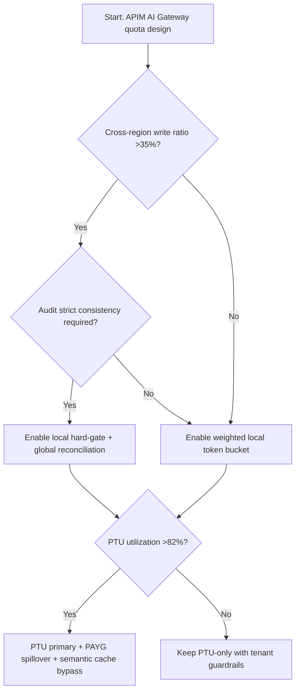
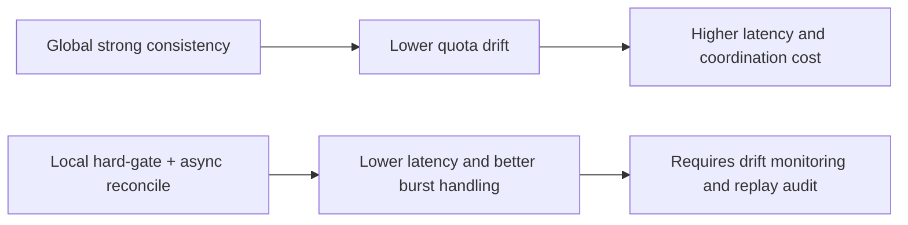
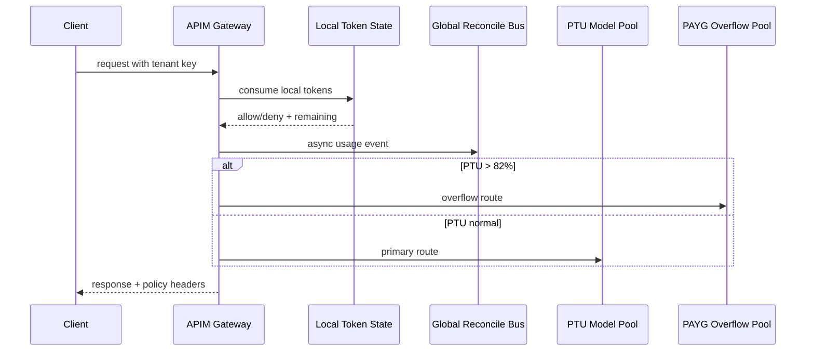

# Agent APIM AI Gateway Token Rate-Limit Cross-Region Consistency Selection FAQ (Azure AI Agent Infra)

## 1) 3-minute conclusions
- **If cross-region quota convergence exceeds 900ms and false-reject rate exceeds 0.5%, adopt local hard-gating plus global soft reconciliation** instead of a single strongly-consistent control point.
- **When spillover exceeds 18% and PTU utilization exceeds 82%, enforce PTU primary + PAYG overflow + semantic-cache bypass**, otherwise both latency and cost degrade together.
- **Stronger consistency is not always better**: regulated finance may trade latency for audit strictness; multi-tenant SaaS should prioritize throughput stability and false-reject control.

## 2) Q1 / Q2 / Q3
- **Core tradeoff?** Consistency versus latency.
- **Why false rejects happen?** Replication lag + burst hotspots + local-window mismatch.
- **Minimum viable policy?** Local hard threshold first, global async reconciliation second, plus tenant weighting and controlled fallback.

### Q1: When is cross-region consistency mandatory?
When cross-region write ratio for a tenant exceeds 35% and audit requires ledger-grade consistency.

### Q2: When is local-only good enough?
When traffic is region-local, latency-sensitive, and can tolerate short quota drift.

### Q3: How to avoid collapse at PTU saturation?
Set `PTU_high_watermark=82%` and trigger PAYG spillover with semantic-cache gate thresholds.

## 3) Mermaid (decision / path / sequence)
### 3.1 Decision tree

### 3.2 Path comparison

### 3.3 Sequence

## 4) Decision matrix
| Dimension | Global strong consistency | Local hard-gate + global soft reconcile (Recommended) |
|---|---:|---:|
| Gateway latency P95 | 420–760ms | 190–360ms |
| Quota drift window | 80–220ms | 220–900ms |
| False reject target | <0.3% | <0.5% |
| Peak throughput elasticity | Medium | High |
| Cost controllability | Medium | High |
| Ops complexity (1-10) | 8 | 7 |

## 5) Formula + 7-card insights
- Drift error: `Drift = |LocalUsed - GlobalSettled| / Quota`
- Spillover cost: `OverflowCost = SpillTokens * PAYG_UnitPrice`
- Example (`synthetic_assumed`):
  - `Quota=1,000,000 tokens/h`
  - `LocalUsed=812,000, GlobalSettled=804,500`
  - `Drift=0.75%`
  - `SpillTokens=96,000, PAYG_UnitPrice=$0.0000022`
  - `OverflowCost=$0.2112/h`
- Evidence pointers:
  - `workshops/azure-agent-infra/evidence/cycle-1448-benchmark.json`
  - `workshops/azure-agent-infra/evidence/cycle-1448-sources.json`
- Source labels: `official` (APIM docs/releases), `synthetic_assumed` (computed examples), `not_measured` (not from production measurements).

## 6) Production verification checklist
- [ ] Rate-limit key includes region + tenant + model tuple
- [ ] `PTU_high_watermark` is linked to PAYG spillover policy
- [ ] False reject, drift, and spillover ratios are covered by alert SLOs
- [ ] Global replay audit is traceable via request IDs
- [ ] FAQ/7-card fields include source labels end-to-end
