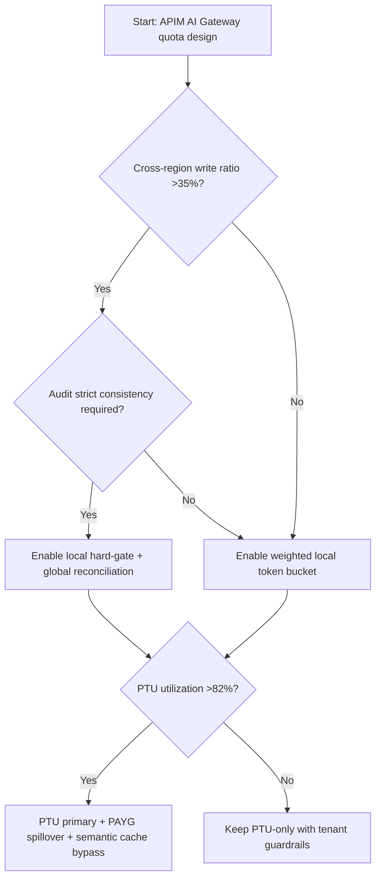
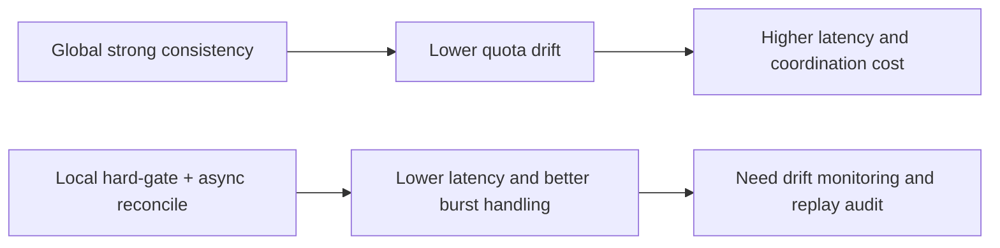
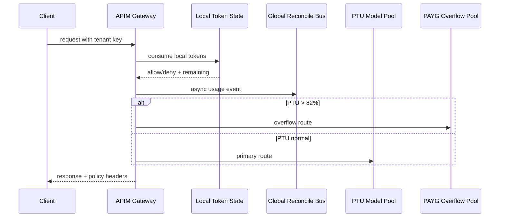

# Agent APIM AI Gateway Token Rate-Limit Cross-Region Consistency 选型 FAQ（Azure AI Agent Infra）

## 1) 3 分钟结论（先看这里）
- **若跨区令牌配额状态收敛时间 >900ms，且误拒率（false reject）>0.5%，应采用“本地区硬门控 + 全局软协调”**，不要做单点强一致中心。
- **当溢出流量占比 >18% 且 PTU 利用率 >82% 时，必须启用“PTU 主路径 + PAYG 溢出 + 语义缓存旁路”三段式**，否则延迟和成本同时失控。
- **跨区一致性不是越强越好**：金融高合规场景可接受更高延迟换审计一致性；SaaS 多租户优先稳定吞吐与误拒率。

## 2) Q1 / Q2 / Q3
- **核心矛盾是什么？**：限流一致性与低延迟天然冲突。
- **为什么会误拒？**：跨区状态复制滞后 + 瞬时热点 + 本地窗口算法偏差。
- **最小可用策略？**：本地硬阈值先挡峰，全局异步回补，配合租户权重和灰度回退。

### Q1：什么时候必须启用跨区一致性模式？
当同一租户跨区写入占比 >35%，且审计要求“账务级一致”时。

### Q2：什么时候只用本地限流？
当请求以单区读写为主、对极低延迟敏感且容忍短时配额漂移时。

### Q3：如何避免 PTU 吃满后雪崩？
提前设定 `PTU_high_watermark=82%` 触发 PAYG 溢出，并绑定语义缓存命中阈值。

## 3) Mermaid（决策树 / 路径 / 时序）
### 3.1 选型决策树

### 3.2 路径对比

### 3.3 时序图

## 4) 选型矩阵
| 维度 | 全局强一致 | 本地硬门+全局软协调（推荐） |
|---|---:|---:|
| P95 网关延迟 | 420–760ms | 190–360ms |
| 配额漂移窗口 | 80–220ms | 220–900ms |
| 误拒率（目标） | <0.3% | <0.5% |
| 峰值吞吐弹性 | 中 | 高 |
| 成本可控性 | 中 | 高 |
| 运维复杂度（1-10） | 8 | 7 |

## 5) 公式与 7-Card 洞察
- 漂移误差：`Drift = |LocalUsed - GlobalSettled| / Quota`
- 溢出成本：`OverflowCost = SpillTokens * PAYG_UnitPrice`
- 示例（`synthetic_assumed`）：
  - `Quota=1,000,000 tokens/h`
  - `LocalUsed=812,000, GlobalSettled=804,500`
  - `Drift=0.75%`
  - `SpillTokens=96,000, PAYG_UnitPrice=$0.0000022`
  - `OverflowCost=$0.2112/h`
- 证据文件：
  - `workshops/azure-agent-infra/evidence/cycle-1448-benchmark.json`
  - `workshops/azure-agent-infra/evidence/cycle-1448-sources.json`
- 来源标签：`official`（APIM 文档/发布）、`synthetic_assumed`（算例）、`not_measured`（未实测）。

## 6) 生产核验 Checklist
- [ ] 租户级限流键包含 region + tenant + model 三元组
- [ ] `PTU_high_watermark` 与 PAYG 溢出规则已联动
- [ ] 误拒率、漂移率、溢出比例进入告警 SLO
- [ ] 全局回放审计可追溯至请求 ID
- [ ] FAQ/7-Card 全部字段完成来源标签标注
