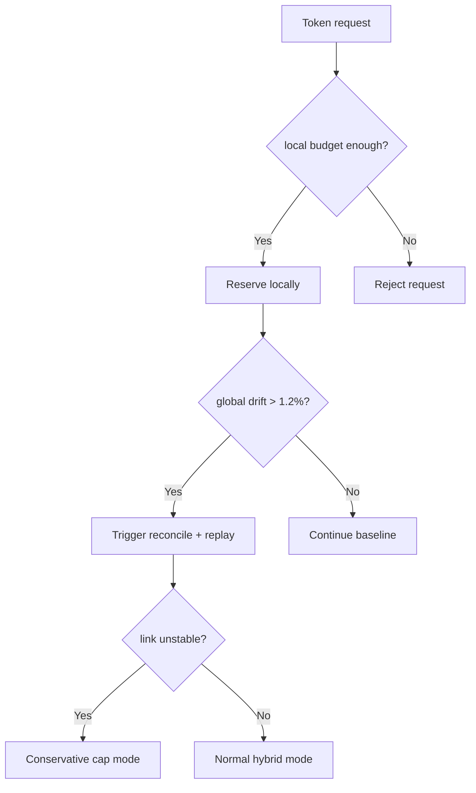
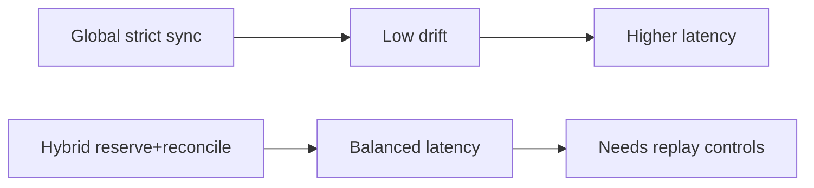
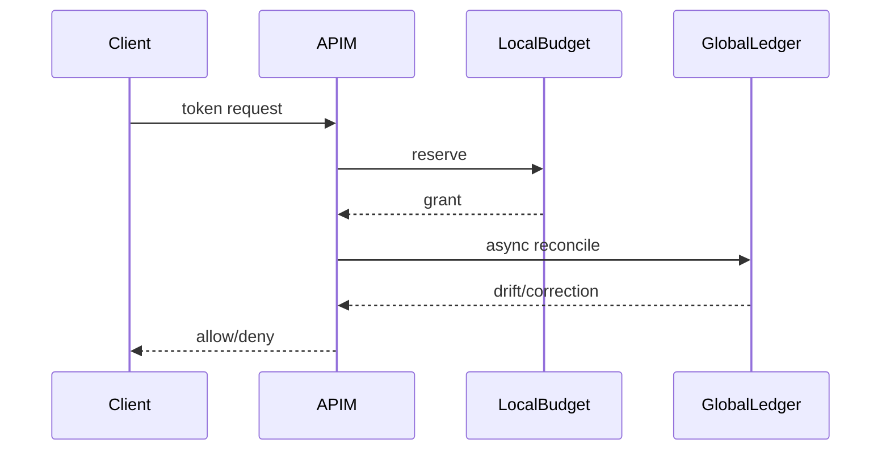

# Agent APIM Token Rate-Limit Cross-Region Reconcile Selection FAQ (Azure AI Agent Infra)

## 1) 3-minute conclusions
- **Without ledger reconciliation, cross-region APIM token limits can show both false reject and oversell simultaneously.**
- **Recommended: local reservation + global reconcile + conflict replay loop.**
- **Targets: `cross_region_drift <1.2%`, `false_reject <0.4%`, `oversell=0`.**

## 2) Q1 / Q2 / Q3
- **Why drift happens?** Region-local counters merge late under bursts.
- **Why not strict global sync for each request?** Higher latency and dependency risk at ingress.
- **Minimum loop?** Fast local path, async global reconcile, replay corrections.

### Q1: When to trigger correction?
When ledger drift exceeds threshold across two windows.

### Q2: When to degrade policy?
When global reconcile path becomes unstable.

### Q3: How to validate gains?
Compare false-reject, oversell, and p95 latency.

## 3) Mermaid diagrams
### 3.1 Decision tree

### 3.2 Path comparison

### 3.3 Sequence

## 4) Decision matrix
| Dimension | Global strict sync | Reserve+reconcile (Recommended) |
|---|---:|---:|
| Drift control | High | High |
| Ingress latency | Medium-low | High |
| Ops complexity (1-10) | 6 | 8 |
| Availability | Medium | High |
| Cost efficiency | Medium | High |

## 5) Quant model + 7-card insights
- Drift rate: `Drift = |RegionalUsed-GlobalUsed|/GlobalUsed`
- Gain: `RejectGain = BaselineFalseReject - HybridFalseReject`
- Example (`synthetic_assumed`):
  - `RegionalUsed=2,021,000, GlobalUsed=2,000,000`
  - `Drift=1.05%`
  - `BaselineFalseReject=0.93%, HybridFalseReject=0.31%`
  - `RejectGain=0.62%`
- Evidence:
  - `workshops/azure-agent-infra/evidence/cycle-1478-benchmark.json`
  - `workshops/azure-agent-infra/evidence/cycle-1478-sources.json`
- Labels: `official/synthetic_assumed/not_measured`.

## 6) Production verification checklist
- [ ] Local reserve and global reconcile windows are versioned
- [ ] Conflict replay path and alerts are traceable
- [ ] Conservative-cap downgrade drill is validated
- [ ] Cross-region drift metrics are visualized
- [ ] FAQ/7-card source labels are complete
