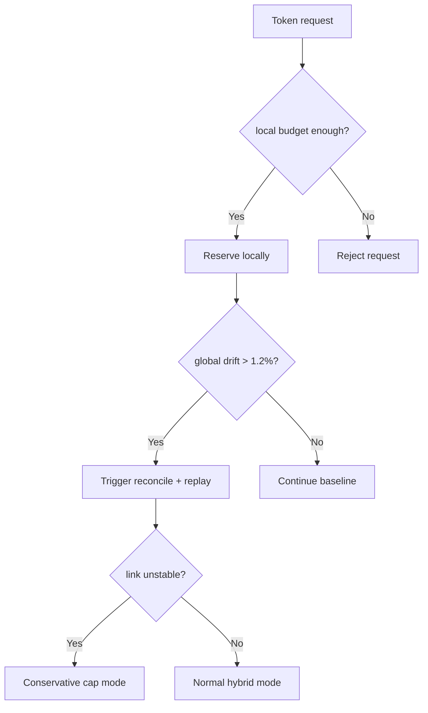
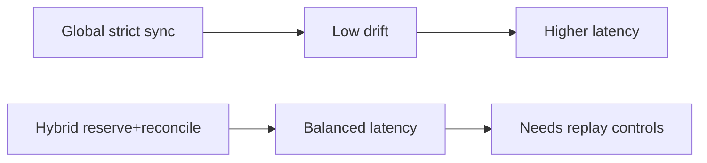
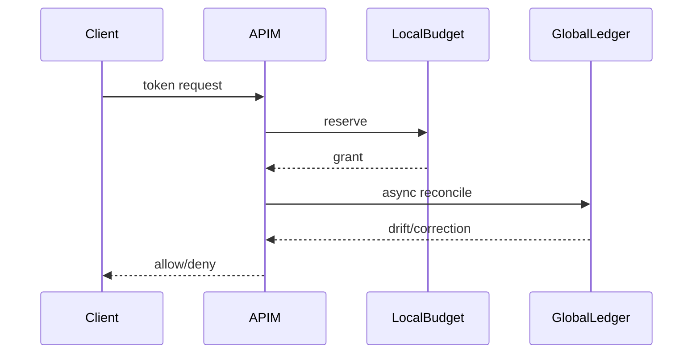

# Agent APIM Token Rate-Limit Cross-Region Reconcile 选型 FAQ（Azure AI Agent Infra）

## 1) 3 分钟结论
- **跨区 APIM Token 限流若缺少账本对账，会出现区域间误拒与超发并存。**
- **推荐“本地预扣 + 全局对账 + 冲突回放”闭环。**
- **目标阈值：`cross_region_drift <1.2%`、`false_reject <0.4%`、`oversell=0`。**

## 2) Q1 / Q2 / Q3
- **为何会漂移？**：区域独立计数在高并发下延迟合并。
- **为何不能全局强一致实时扣减？**：高延迟与链路风险影响入口吞吐。
- **最小闭环？**：本地快路径、异步全局对账、冲突纠偏。

### Q1：何时触发纠偏？
账本差异超阈值并持续 2 个窗口。

### Q2：何时降级策略？
全局对账链路抖动时启用保守配额。

### Q3：如何验证收益？
对比误拒率、超发率、P95 延迟。

## 3) Mermaid 图
### 3.1 决策树

### 3.2 路径对比

### 3.3 时序

## 4) 决策矩阵
| 维度 | 全局强一致 | 预扣+对账（推荐） |
|---|---:|---:|
| 漂移控制 | 高 | 高 |
| 入口延迟 | 中低 | 高 |
| 运维复杂度（1-10） | 6 | 8 |
| 可用性 | 中 | 高 |
| 成本效率 | 中 | 高 |

## 5) 定量算例与 7-Card 洞察
- 漂移率：`Drift = |RegionalUsed-GlobalUsed|/GlobalUsed`
- 收益：`RejectGain = BaselineFalseReject - HybridFalseReject`
- 示例（`synthetic_assumed`）：
  - `RegionalUsed=2,021,000, GlobalUsed=2,000,000`
  - `Drift=1.05%`
  - `BaselineFalseReject=0.93%, HybridFalseReject=0.31%`
  - `RejectGain=0.62%`
- 证据：
  - `workshops/azure-agent-infra/evidence/cycle-1478-benchmark.json`
  - `workshops/azure-agent-infra/evidence/cycle-1478-sources.json`
- 标签：`official/synthetic_assumed/not_measured`。

## 6) 生产核验 Checklist
- [ ] 本地预扣与全局对账窗口参数版本化
- [ ] 冲突回放链路与告警可追溯
- [ ] 保守配额降级策略演练通过
- [ ] cross-region drift 指标可视化
- [ ] FAQ/7-Card 来源标签完整
