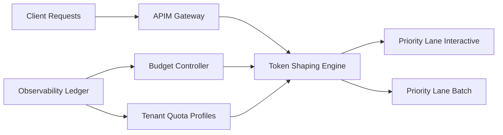

# APIM Token Shaping Guardrail Selection FAQ (Cycle 1850)

## 1) Three-minute decision
- **Core tradeoff:** unlimited token throughput can improve short-term responsiveness but drives bursty cost and model queueing; strict throttles can harm critical workflows.
- **Recommendation:** layered APIM token shaping (tenant quotas, scenario priority lanes, peak clipping) with budget feedback loops.
- **Goal:** protect critical success rates while stabilizing token cost and tail latency.

## 2) Q1 / Q2 / Q3
### Q1: Why is RPM/QPS-only throttling insufficient?
1) equal request counts map to very different token spend,
2) long-context requests can starve short interactive calls,
3) request-rate limits do not align directly with budget controls.

### Q2: What production-grade token-shaping guardrail should be used?
- **Tenant quotas:** hourly/daily token budgets with elastic credits,
- **Scenario priority:** interactive lanes first, batch lanes deferrable,
- **Peak clipping:** smooth token burst rates under spike windows,
- **Budget loop:** tighten noncritical lanes as spend approaches thresholds.

### Q3: How do we validate stable cost with good UX?
- critical-path success rate remains in target range,
- token-cost variance converges,
- P95 latency stays bounded under burst load.

## 3) Reference architecture

## 4) Decision matrix
| Dimension | RPM/QPS-only throttling | Token-shaping guardrails (Recommended) |
|---|---:|---:|
| Cost controllability | Low | High |
| Critical-path protection | Medium | High |
| Tail-latency stability | Low | High |
| Implementation complexity | Low | Medium |
| Multi-tenant fairness | Low | High |

## 5) Evidence and reproducibility
- Evidence files:
  - `workshops/azure-agent-infra/evidence/cycle-1850-benchmark.json`
  - `workshops/azure-agent-infra/evidence/cycle-1850-latency.csv`
  - `workshops/azure-agent-infra/evidence/cycle-1850-throughput.csv`
  - `workshops/azure-agent-infra/evidence/cycle-1850-policy.csv`
- Labels: `measured / synthetic / anonymized_reported`.
- validation7 enforces bilingual six-part structure, CSP self-contained 7-card output, strict cycle-evidence alignment, and replayability.

## 6) Production checklist
- [ ] Tenant token quotas and elastic credits are active.
- [ ] Scenario-priority laneing is enforced.
- [ ] Peak-clipping behavior is stable under load.
- [ ] Budget feedback loop is triggerable and auditable.
- [ ] FAQ/H5/SVG/7-card align with cycle evidence.
