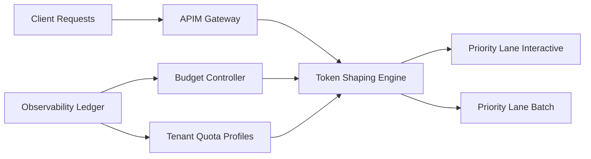

# APIM Token Shaping 护栏选型 FAQ（Cycle 1850）

## 1) 3 分钟结论
- **核心矛盾：** 不限流 token 吞吐可短期提升体验，但会造成突发成本失控与下游模型排队；过严限流又会拖慢关键业务。
- **推荐：** APIM 分层 token shaping（租户配额 + 场景优先级 + 峰值削顶）+ 预算闭环。
- **目标：** 在保障关键请求成功率的同时，稳定 token 成本和延迟尾部。

## 2) Q1 / Q2 / Q3
### Q1：为什么仅靠 RPM/QPS 限流不够？
1) 相同请求数对应的 token 消耗差异很大；
2) 长上下文请求会挤占短请求资源，造成体验不公平；
3) 无法直接对齐预算与成本治理目标。

### Q2：生产级 token shaping 护栏怎么做？
- **租户配额：** 按日/小时 token 预算与弹性额度；
- **场景优先级：** 交互式请求高优先，离线批处理可延迟；
- **峰值削顶：** 突发窗口触发 token 速率平滑；
- **预算回路：** 成本逼近阈值时动态收紧非关键流量。

### Q3：如何验证护栏“稳成本且保体验”？
- 关键路径成功率保持目标区间；
- token 成本波动收敛；
- P95 延迟在突发流量下可控。

## 3) 架构图

## 4) 选型矩阵
| 维度 | 仅 RPM/QPS 限流 | Token Shaping 护栏（推荐） |
|---|---:|---:|
| 成本可控性 | 低 | 高 |
| 关键路径保障 | 中 | 高 |
| 尾延迟稳定性 | 低 | 高 |
| 实施复杂度 | 低 | 中 |
| 多租户公平性 | 低 | 高 |

## 5) 证据与复算口径
- 证据文件：
  - `workshops/azure-agent-infra/evidence/cycle-1850-benchmark.json`
  - `workshops/azure-agent-infra/evidence/cycle-1850-latency.csv`
  - `workshops/azure-agent-infra/evidence/cycle-1850-throughput.csv`
  - `workshops/azure-agent-infra/evidence/cycle-1850-policy.csv`
- 标签：`measured / synthetic / anonymized_reported`。
- validation7：双语六段结构、7-card CSP 自包含、轮次与 evidence 一致、可回放链路通过。

## 6) 生产检查清单
- [ ] 租户 token 配额与弹性额度已上线。
- [ ] 场景优先级与流量分层生效。
- [ ] 峰值削顶策略在压测下稳定。
- [ ] 预算回路可触发并可审计。
- [ ] FAQ/H5/SVG/7-card 与 evidence 轮次一致。
