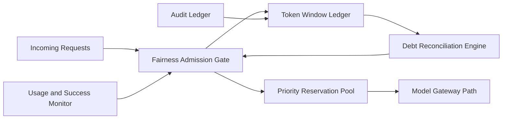

# APIM Token Window Fairness Admission Selection FAQ (Cycle 1888)

## 1) Three-minute decision
- **Core issue:** without fairness-aware token-window admission, high-throughput tenants can permanently crowd shared model quotas.
- **Recommendation:** combine windowed fair quotas, debt reconciliation, and priority reservation pools.
- **Goal:** protect critical throughput while reducing quota skew and tenant starvation.

## 2) Q1 / Q2 / Q3
### Q1: Why does simple rate limiting hurt fairness?
1) static thresholds ignore historical overuse,
2) first-come-first-served amplifies imbalance at peaks,
3) critical and non-critical traffic are not differentiated.

### Q2: How should production token-window fairness admission be designed?
- **Window quotas:** track token use per tenant by minute/hour windows,
- **Debt model:** overuse creates debt to reconcile in later windows,
- **Reservation pool:** maintain minimum token budget for critical paths,
- **Dynamic gating:** tune thresholds from consumption and success signals.

### Q3: What is the go-live bar?
- lower cross-tenant token-usage variance,
- critical throughput/success remain within targets,
- debt reconciliation does not trigger rejection oscillation.

## 3) Reference architecture

## 4) Decision matrix
| Dimension | Fixed rate limiting | Windowed fairness admission (Recommended) |
|---|---:|---:|
| Multi-tenant fairness | Low | High |
| Critical-path protection | Medium | High |
| Throughput stability | Medium | High |
| Implementation complexity | Low | Medium |
| Policy explainability | Medium | High |

## 5) Evidence and reproducibility
- Evidence files:
  - `workshops/azure-agent-infra/evidence/cycle-1888-benchmark.json`
  - `workshops/azure-agent-infra/evidence/cycle-1888-latency.csv`
  - `workshops/azure-agent-infra/evidence/cycle-1888-throughput.csv`
  - `workshops/azure-agent-infra/evidence/cycle-1888-policy.csv`
- Labels: `measured / synthetic / anonymized_reported`.
- validation7 enforces six-part structure, CSP-safe 7-card output, strict cycle-topic alignment, and replayable checks.

## 6) Production checklist
- [ ] Token-window accounting aligns with tenant identities.
- [ ] Debt reconciliation policy passes peak tests.
- [ ] Priority reservation pool is integrated.
- [ ] Dynamic gate thresholds converge in peak windows.
- [ ] FAQ/H5/SVG/7-card/evidence remain cycle-consistent.
