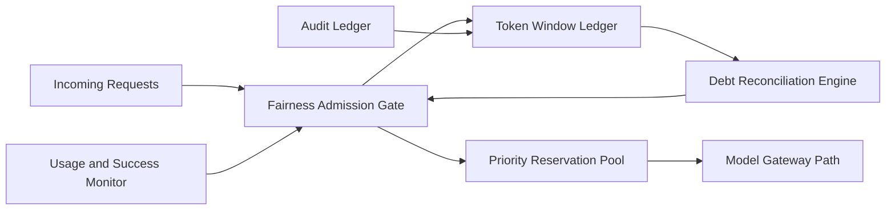

# APIM Token Window Fairness Admission 选型 FAQ（Cycle 1888）

## 1) 3 分钟结论
- **核心问题：** 多租户高并发场景下，token 消耗窗口若不做公平准入，会导致高吞吐租户长期挤占模型配额。
- **推荐方案：** “时间窗公平配额 + 债务回补机制 + 优先级保留池”组合。
- **目标：** 在保障关键业务吞吐的同时抑制配额倾斜与饥饿。

## 2) Q1 / Q2 / Q3
### Q1：为什么简单限流会伤害公平性？
1) 固定阈值无法反映租户历史透支；
2) 高峰期先到先得会放大资源不均；
3) 关键与非关键请求缺乏差异化保障。

### Q2：生产级 token window fairness admission 如何设计？
- **时间窗配额：** 按分钟/小时窗口统计租户 token 使用；
- **债务机制：** 超额租户形成债务并在后续窗口回补；
- **保留池：** 为关键链路保留最小 token 配额；
- **动态门控：** 依据窗口耗用率和成功率调整准入阈值。

### Q3：上线判据是什么？
- 租户间 token 占用方差显著下降；
- 关键请求吞吐与成功率维持目标；
- 债务回补不引发大规模拒绝抖动。

## 3) 架构图

## 4) 选型矩阵
| 维度 | 固定限流 | 时间窗公平准入（推荐） |
|---|---:|---:|
| 多租户公平性 | 低 | 高 |
| 关键链路保障 | 中 | 高 |
| 吞吐稳定性 | 中 | 高 |
| 实施复杂度 | 低 | 中 |
| 策略可解释性 | 中 | 高 |

## 5) 证据与复算口径
- 证据文件：
  - `workshops/azure-agent-infra/evidence/cycle-1888-benchmark.json`
  - `workshops/azure-agent-infra/evidence/cycle-1888-latency.csv`
  - `workshops/azure-agent-infra/evidence/cycle-1888-throughput.csv`
  - `workshops/azure-agent-infra/evidence/cycle-1888-policy.csv`
- 标签：`measured / synthetic / anonymized_reported`。
- validation7：六段结构、7-card CSP、cycle-topic 对齐、验证链可回放。

## 6) 生产检查清单
- [ ] token 时间窗统计与租户标签对齐。
- [ ] 债务回补策略完成峰值压测。
- [ ] 关键保留池与优先级策略联调通过。
- [ ] 动态门控阈值在高峰窗口可收敛。
- [ ] FAQ/H5/SVG/7-card/evidence 轮次一致。
