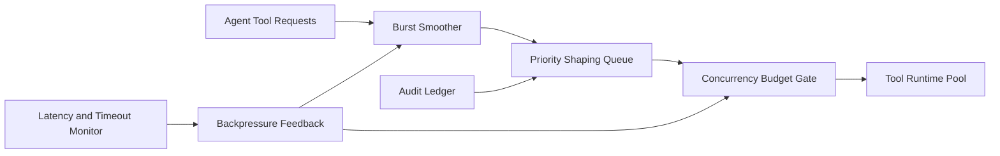

# APIM Tool Call Burst Smoothing Selection FAQ (Cycle 1876)

## 1) Three-minute decision
- **Core issue:** peak tool-call bursts create queue spikes, inflate P99 latency, and trigger cascading timeouts.
- **Recommendation:** combine burst smoothing, tiered concurrency budgets, and priority-shaped queues.
- **Goal:** flatten peak volatility and stabilize tail latency without sacrificing critical task success.

## 2) Q1 / Q2 / Q3
### Q1: Why is fixed rate limiting insufficient?
1) static thresholds cannot adapt to intra-day peaks,
2) cost/latency profiles vary by tool family,
3) critical and background flows require differentiated protection.

### Q2: How should production burst smoothing be implemented?
- **Burst smoother:** shave instant spikes with short-window buffering,
- **Concurrency budgets:** tiered quotas by tool family and tenant class,
- **Priority shaping:** allow critical calls to preempt lower-priority windows,
- **Backpressure feedback:** tighten/relax windows from downstream latency signals.

### Q3: What is the go-live bar?
- converged P95/P99 tool-call latency curves,
- stable success rates for critical tasks,
- lower downstream timeout and retry-storm rates.

## 3) Reference architecture

## 4) Decision matrix
| Dimension | Fixed rate limiting | Smoothing + tiered budgets (Recommended) |
|---|---:|---:|
| Peak shaving capability | Low | High |
| Tail-latency stability | Low | High |
| Critical-path protection | Medium | High |
| Implementation complexity | Low | Medium |
| Operational observability | Medium | High |

## 5) Evidence and reproducibility
- Evidence files:
  - `workshops/azure-agent-infra/evidence/cycle-1876-benchmark.json`
  - `workshops/azure-agent-infra/evidence/cycle-1876-latency.csv`
  - `workshops/azure-agent-infra/evidence/cycle-1876-throughput.csv`
  - `workshops/azure-agent-infra/evidence/cycle-1876-policy.csv`
- Labels: `measured / synthetic / anonymized_reported`.
- validation7 enforces six-part structure, CSP-safe 7-card output, strict cycle-topic alignment, and replayable checks.

## 6) Production checklist
- [ ] Burst-smoothing window parameters are load-calibrated.
- [ ] Tiered concurrency budgets cover core tool families.
- [ ] Priority shaping queue passes failure drills.
- [ ] Backpressure thresholds and alerts are integrated.
- [ ] FAQ/H5/SVG/7-card/evidence remain cycle-consistent.
