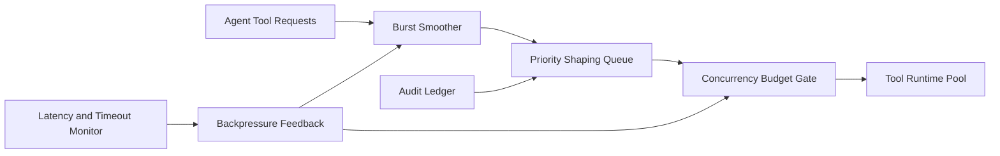

# APIM Tool Call Burst Smoothing 选型 FAQ（Cycle 1876）

## 1) 3 分钟结论
- **核心问题：** Agent 工具调用在峰值突发时会形成排队尖峰，拉高 P99 并诱发级联超时。
- **推荐方案：** “突发平滑器 + 分层并发预算 + 优先级整形队列”三段治理。
- **目标：** 在不牺牲核心任务成功率前提下压平峰值波动并稳定尾延迟。

## 2) Q1 / Q2 / Q3
### Q1：为什么仅靠固定限流不足？
1) 固定阈值无法适应时段性峰谷；
2) 不同工具链路成本差异大；
3) 关键任务与后台任务需差异化保障。

### Q2：生产级 burst smoothing 如何设计？
- **突发平滑器：** 对瞬时工具调用峰值做速率削峰与短时缓冲；
- **并发预算：** 按工具族、租户等级配置分层配额；
- **优先级整形：** 关键调用抢占低优先级窗口；
- **回压反馈：** 根据下游响应时间动态收紧/放宽窗口。

### Q3：上线判据是什么？
- 工具调用 P95/P99 时延曲线明显收敛；
- 关键任务成功率保持稳定；
- 下游超时率与重试风暴显著下降。

## 3) 架构图

## 4) 选型矩阵
| 维度 | 固定限流 | 平滑+分层预算（推荐） |
|---|---:|---:|
| 峰值削峰能力 | 低 | 高 |
| 尾延迟稳定性 | 低 | 高 |
| 关键任务保障 | 中 | 高 |
| 实施复杂度 | 低 | 中 |
| 运维可观测性 | 中 | 高 |

## 5) 证据与复算口径
- 证据文件：
  - `workshops/azure-agent-infra/evidence/cycle-1876-benchmark.json`
  - `workshops/azure-agent-infra/evidence/cycle-1876-latency.csv`
  - `workshops/azure-agent-infra/evidence/cycle-1876-throughput.csv`
  - `workshops/azure-agent-infra/evidence/cycle-1876-policy.csv`
- 标签：`measured / synthetic / anonymized_reported`。
- validation7：六段结构、7-card CSP、cycle-topic 对齐、验证链可回放。

## 6) 生产检查清单
- [ ] 突发平滑窗口参数完成压测校准。
- [ ] 分层并发预算覆盖核心工具族。
- [ ] 优先级整形队列通过故障演练。
- [ ] 回压反馈阈值与告警联调通过。
- [ ] FAQ/H5/SVG/7-card/evidence 轮次一致。
