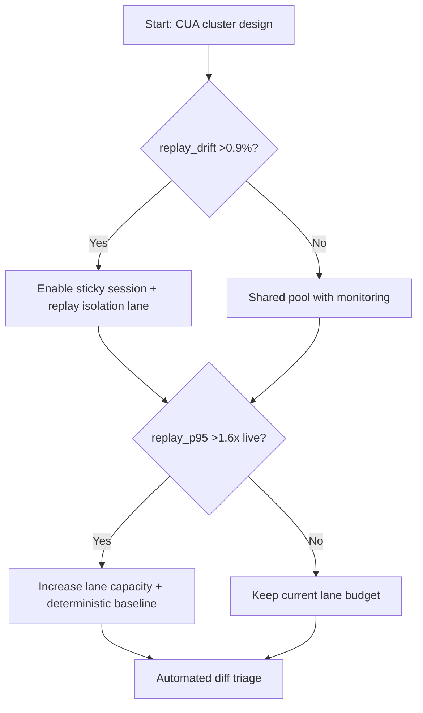
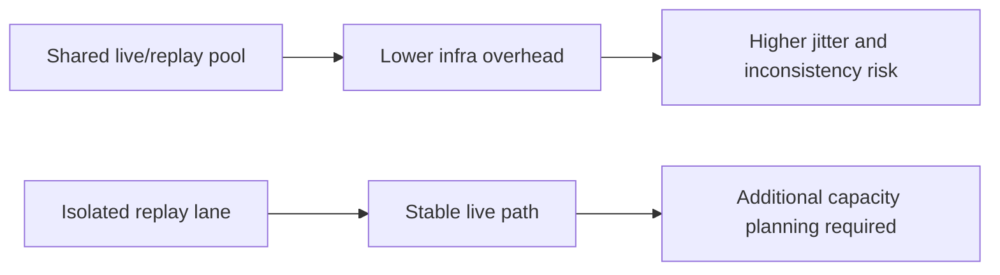
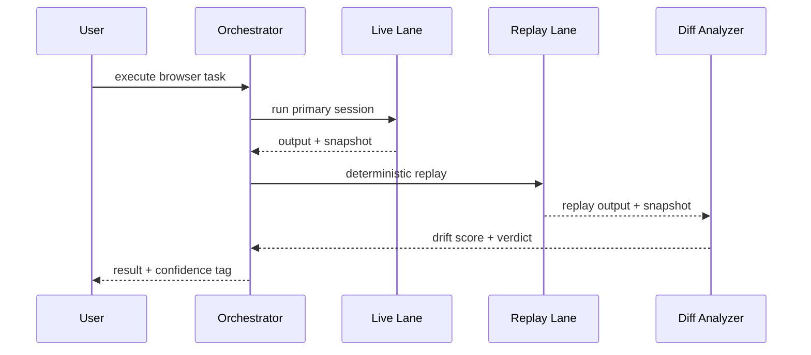

# Agent Browser/CUA Cluster Replay Isolation Selection FAQ (Azure AI Agent Infra)

## 1) 3-minute conclusions
- **If CUA replay inconsistency exceeds 1.2% or cross-node drift exceeds 0.9%, enforce sticky sessions + replay-isolation lane + deterministic snapshot baseline**.
- **Mixing replay and live execution in the same pool introduces contention jitter; keep replay as a separate controlled preemptible lane.**
- **Production thresholds: replay P95 <=1.6x live execution and drift-alert MTTR <15 minutes.**

## 2) Q1 / Q2 / Q3
- **Why does replay diverge from live?** Browser/version/font/network variance plus scheduling contention.
- **Why isolate replay lane?** Replay is diagnostic workload and should not degrade interactive traffic.
- **Minimum viable loop?** Pinned runtime image, sticky scheduling, diff snapshots, automatic regression verdict.

### Q1: When is sticky scheduling mandatory?
When same-session cross-node migration exceeds 8% with rising diff alerts.

### Q2: When can pools be shared?
Small internal validation setups without external SLO commitments.

### Q3: How to evaluate replay cost?
Use replay-time overhead versus reduction in incident diagnosis time.

## 3) Mermaid diagrams
### 3.1 Decision tree

### 3.2 Path comparison

### 3.3 Sequence

## 4) Decision matrix
| Dimension | Shared pool | Isolated replay lane (Recommended) |
|---|---:|---:|
| Live-path jitter | Medium-high | Low |
| Replay consistency | 97.8%–99.0% | 99.1%–99.8% |
| Diagnostics efficiency | Medium | High |
| Resource cost | Low | Medium |
| Ops complexity (1-10) | 5 | 8 |

## 5) Quant model + 7-card insights
- Drift rate: `DriftRate = DriftedReplays / TotalReplays`
- Replay cost: `ReplayCost = ReplayMinutes * UnitPrice`
- Example (`synthetic_assumed`):
  - `DriftedReplays=42, TotalReplays=3,200`
  - `DriftRate=1.31%`
  - `ReplayMinutes=860, UnitPrice=$0.0023`
  - `ReplayCost=$1.978`
- Evidence:
  - `workshops/azure-agent-infra/evidence/cycle-1454-benchmark.json`
  - `workshops/azure-agent-infra/evidence/cycle-1454-sources.json`
- Labels: `official/synthetic_assumed/not_measured`.

## 6) Production verification checklist
- [ ] Replay lane and live lane are resource-isolated
- [ ] Browser image/font/dependency versions are pinned and traceable
- [ ] Sticky-session and replay-priority policies are validated
- [ ] Drift analysis alerts are tied to automatic regression classification
- [ ] FAQ/7-card source labels and timestamps are complete
