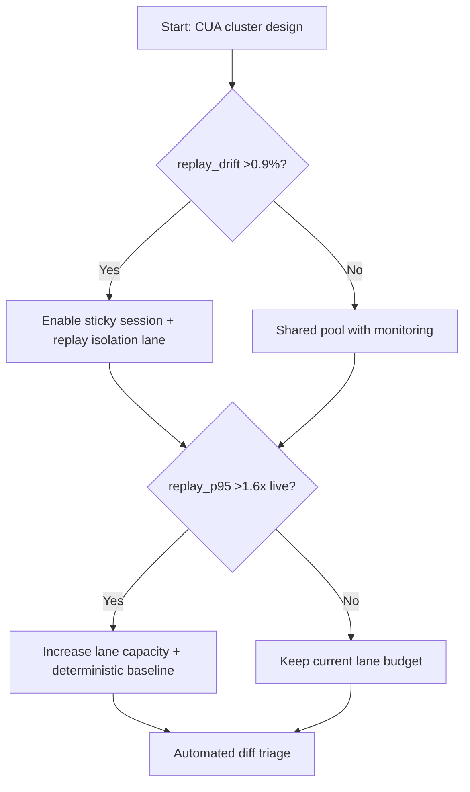
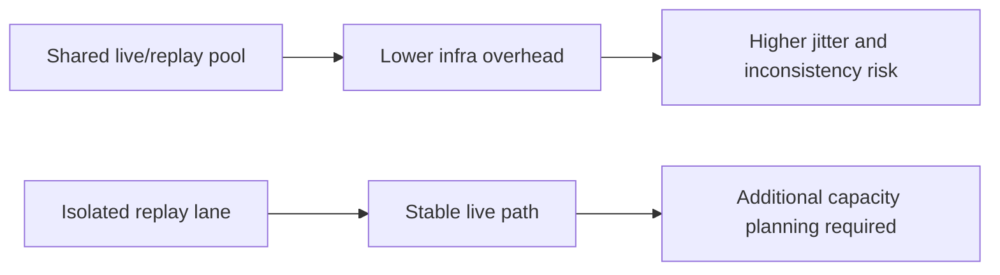
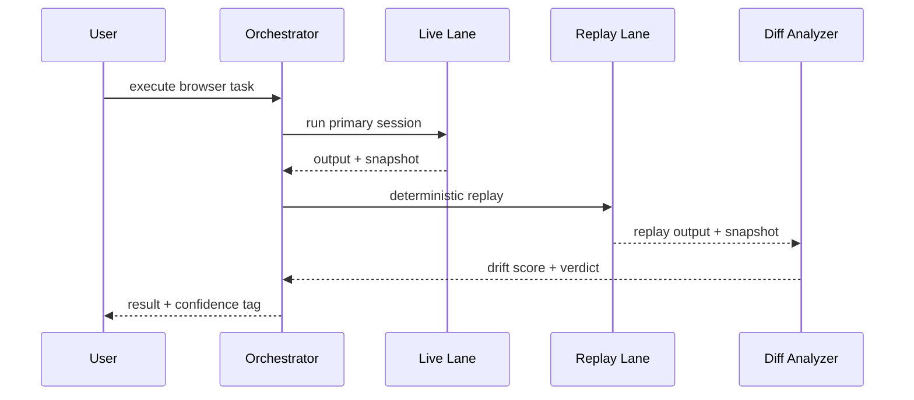

# Agent Browser/CUA Cluster Replay Isolation 选型 FAQ（Azure AI Agent Infra）

## 1) 3 分钟结论
- **当 CUA 任务重放不一致率 >1.2% 或跨节点漂移 >0.9% 时，必须启用“会话粘滞 + 回放隔离队列 + 确定性截图基线”**。
- **把回放和在线执行混在同一资源池会导致抢占抖动；建议将 replay lane 独立为低优先级但可抢占受控池。**
- **生产阈值：重放 P95 耗时 ≤1.6x 在线执行，差异告警 MTTR <15 分钟。**

## 2) Q1 / Q2 / Q3
- **为什么同一脚本回放结果会不一样？**：浏览器版本、字体、网络抖动、并发抢占带来非确定性。
- **为什么要隔离回放车道？**：回放是诊断工作负载，不应影响实时交互链路。
- **最小闭环？**：固定运行镜像、粘滞调度、差异快照、自动回归判定。

### Q1：何时必须开粘滞调度？
当同会话跨节点迁移率 >8% 且 diff 报警持续上升时。

### Q2：何时可以共享池？
小规模内部验证环境且不承诺对外 SLO。

### Q3：如何评估回放成本？
用“回放耗时增量 + 诊断收益（故障定位缩短时间）”衡量 ROI。

## 3) Mermaid 图
### 3.1 决策树

### 3.2 路径对比

### 3.3 时序

## 4) 决策矩阵
| 维度 | 共享池 | 回放隔离车道（推荐） |
|---|---:|---:|
| 在线链路抖动 | 中高 | 低 |
| 回放一致性 | 97.8%–99.0% | 99.1%–99.8% |
| 诊断效率 | 中 | 高 |
| 资源成本 | 低 | 中 |
| 运维复杂度（1-10） | 5 | 8 |

## 5) 定量算例与 7-Card 洞察
- 漂移率：`DriftRate = DriftedReplays / TotalReplays`
- 回放溢出成本：`ReplayCost = ReplayMinutes * UnitPrice`
- 示例（`synthetic_assumed`）：
  - `DriftedReplays=42, TotalReplays=3,200`
  - `DriftRate=1.31%`
  - `ReplayMinutes=860, UnitPrice=$0.0023`
  - `ReplayCost=$1.978`
- 证据：
  - `workshops/azure-agent-infra/evidence/cycle-1454-benchmark.json`
  - `workshops/azure-agent-infra/evidence/cycle-1454-sources.json`
- 标签：`official/synthetic_assumed/not_measured`。

## 6) 生产核验 Checklist
- [ ] 回放车道与在线车道资源隔离已生效
- [ ] 浏览器镜像、字体、依赖版本固定并可追溯
- [ ] 会话粘滞策略与回放任务优先级策略已验证
- [ ] 差异分析告警与自动回归判断联动
- [ ] FAQ/7-Card 来源、标签、时间戳完整
