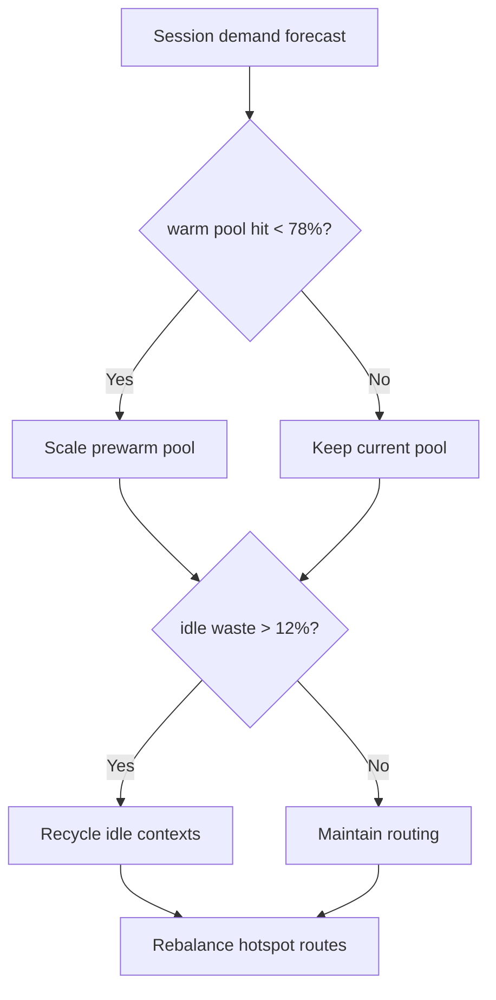
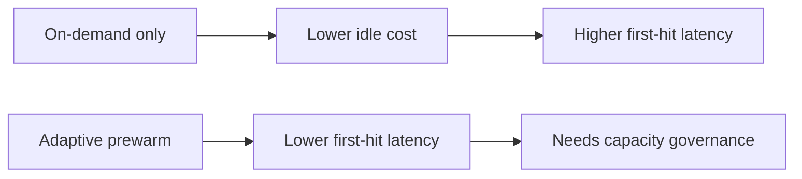
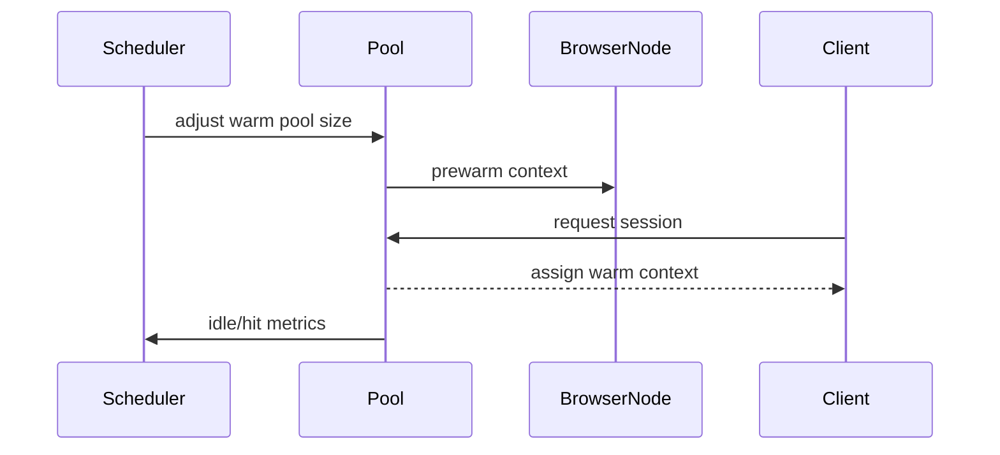

# Agent Browser CUA Cluster Session Prewarm Selection FAQ (Azure AI Agent Infra)

## 1) 3-minute conclusions
- **Without session prewarm, Browser/CUA clusters show amplified first-action latency under bursts.**
- **Use tiered prewarm pools + idle recycle + hotspot routing.**
- **Targets: `first_action_p95 <1.2s`, `warm_pool_hit >78%`, `idle_waste <12%`.**

## 2) Q1 / Q2 / Q3
- **Why first-hit is slow?** Browser context init and policy bootstrap are expensive.
- **Why not keep everything warm?** Idle resource waste and cost are too high.
- **Minimum loop?** Load-based prewarm, idle recycle, hotspot-aware dispatch.

### Q1: When to scale up warm pool?
When forecast load rises and hit rate drops.

### Q2: When to scale down?
When idle ratio exceeds threshold across windows.

### Q3: How to validate gain?
Compare first-hit latency and idle cost.

## 3) Mermaid diagrams
### 3.1 Decision tree

### 3.2 Path comparison

### 3.3 Sequence

## 4) Decision matrix
| Dimension | Pure on-demand startup | Adaptive prewarm (Recommended) |
|---|---:|---:|
| First-action latency | Lower score | Higher score |
| Resource utilization | Medium | High |
| Ops complexity (1-10) | 4 | 7 |
| Peak stability | Medium-low | High |
| Cost control | Medium | High |

## 5) Quant model + 7-card insights
- First-hit gain: `LatencyGain = OnDemandP95 - PrewarmP95`
- Idle waste: `IdleWaste = IdleContexts / TotalWarmContexts`
- Example (`synthetic_assumed`):
  - `OnDemandP95=2.6s, PrewarmP95=1.1s`
  - `LatencyGain=1.5s`
  - `IdleContexts=84, TotalWarmContexts=730`
  - `IdleWaste=11.5%`
- Evidence:
  - `workshops/azure-agent-infra/evidence/cycle-1479-benchmark.json`
  - `workshops/azure-agent-infra/evidence/cycle-1479-sources.json`
- Labels: `official/synthetic_assumed/not_measured`.

## 6) Production verification checklist
- [ ] Prewarm scale thresholds are configurable and auditable
- [ ] Idle recycle windows and anti-flap controls are validated
- [ ] Hotspot routing hit-rate dashboards are available
- [ ] First-action p95 and cost alerts are linked
- [ ] FAQ/7-card source labels are complete
