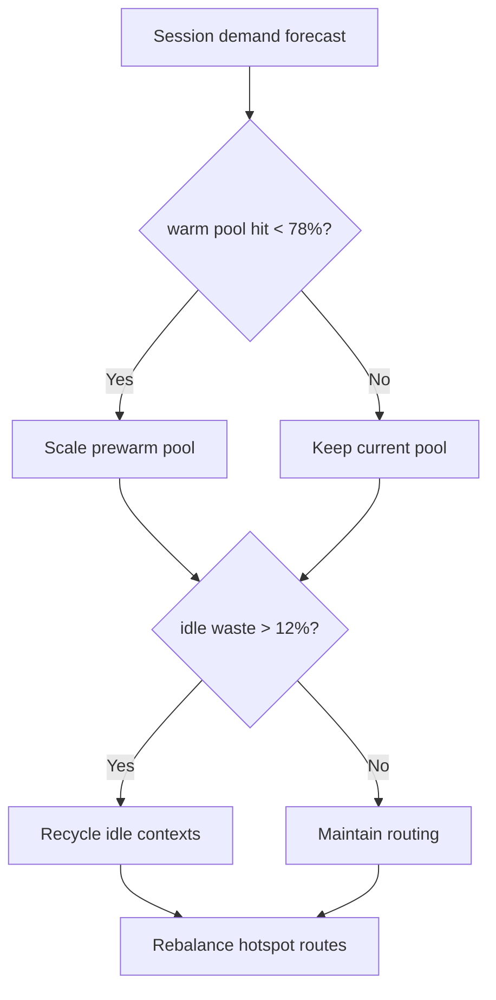
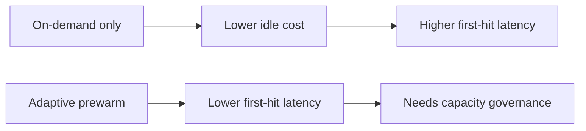
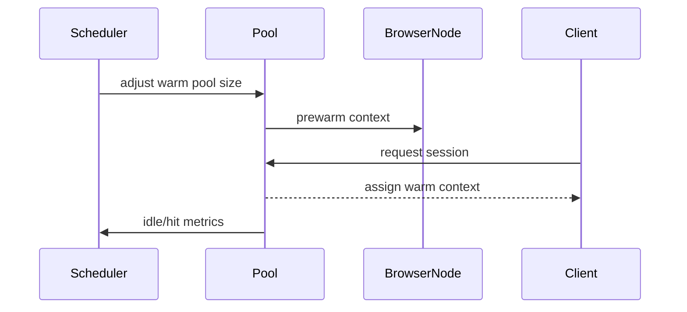

# Agent Browser CUA Cluster Session Prewarm 选型 FAQ（Azure AI Agent Infra）

## 1) 3 分钟结论
- **Browser/CUA 集群若无会话预热，交互首击延迟会在峰值时放大。**
- **推荐“分层预热池 + 空闲回收 + 热点路由”策略。**
- **目标阈值：`first_action_p95 <1.2s`、`warm_pool_hit >78%`、`idle_waste <12%`。**

## 2) Q1 / Q2 / Q3
- **为何首击慢？**：浏览器上下文初始化和策略注入成本高。
- **为何不能全量常驻？**：资源成本与空闲浪费过高。
- **最小闭环？**：按负载预热、按空闲回收、按热点命中。

### Q1：何时扩容预热池？
预测负载超阈值且命中率下降。

### Q2：何时收缩？
空闲率超阈值并持续多个窗口。

### Q3：如何验证收益？
比较首击延迟与空闲成本。

## 3) Mermaid 图
### 3.1 决策树

### 3.2 路径对比

### 3.3 时序

## 4) 决策矩阵
| 维度 | 纯按需启动 | 自适应预热（推荐） |
|---|---:|---:|
| 首击延迟 | 低分 | 高分 |
| 资源利用率 | 中 | 高 |
| 运维复杂度（1-10） | 4 | 7 |
| 峰值稳定性 | 中低 | 高 |
| 成本可控性 | 中 | 高 |

## 5) 定量算例与 7-Card 洞察
- 首击收益：`LatencyGain = OnDemandP95 - PrewarmP95`
- 空闲浪费：`IdleWaste = IdleContexts / TotalWarmContexts`
- 示例（`synthetic_assumed`）：
  - `OnDemandP95=2.6s, PrewarmP95=1.1s`
  - `LatencyGain=1.5s`
  - `IdleContexts=84, TotalWarmContexts=730`
  - `IdleWaste=11.5%`
- 证据：
  - `workshops/azure-agent-infra/evidence/cycle-1479-benchmark.json`
  - `workshops/azure-agent-infra/evidence/cycle-1479-sources.json`
- 标签：`official/synthetic_assumed/not_measured`。

## 6) 生产核验 Checklist
- [ ] 预热池扩缩容阈值可配置可审计
- [ ] 空闲回收窗口与防抖策略验证通过
- [ ] 热点路由命中率有可视化看板
- [ ] first-action p95 与成本联动告警已接入
- [ ] FAQ/7-Card 来源标签完整
