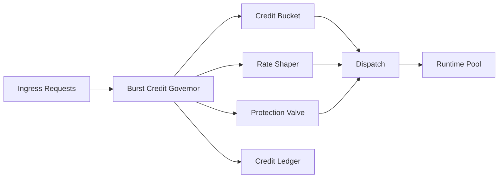

# Agent Burst Credit Governor Selection FAQ (Cycle 1817)

## 1) Three-minute decision
- **Core issue:** steady-state capacity can be sufficient, but burst spikes can still punch through shared pools and inflate global tail latency.
- **Recommendation:** burst credit per tenant + rate shaping + circuit-break fallback.
- **Goal:** release short-lived elasticity within budget while preventing cascading failures.

## 2) Q1 / Q2 / Q3
### Q1: Why is fixed rate limiting alone insufficient?
1) it suppresses healthy short peaks,
2) shared hard thresholds hurt both fairness and efficiency,
3) without credit ledgers, burst incident forensics are weak.

### Q2: What burst-credit strategy is production-ready?
- **Credit bucket:** recoverable burst credits per tenant,
- **Shaper:** smooth request output over windows,
- **Protection valve:** downgrade or break when budget is exceeded,
- **Ledger:** record credit spend, recovery, preemption, and rejection events.

### Q3: How do we validate effectiveness?
- controlled P95/P99 during burst windows,
- bounded reject/degrade rates,
- reduced SLO violation rates for critical tenants.

## 3) Reference architecture

## 4) Decision matrix
| Dimension | Fixed rate limiting | Burst credit governor (Recommended) |
|---|---:|---:|
| Peak elasticity | Low | High |
| Global stability | Medium | High |
| Fairness governance | Medium | High |
| Implementation complexity | Low | Medium |
| Audit traceability | Low | High |

## 5) Evidence and reproducibility
- Evidence files:
  - `workshops/azure-agent-infra/evidence/cycle-1817-benchmark.json`
  - `workshops/azure-agent-infra/evidence/cycle-1817-latency.csv`
  - `workshops/azure-agent-infra/evidence/cycle-1817-throughput.csv`
  - `workshops/azure-agent-infra/evidence/cycle-1817-policy.csv`
- Labels: `measured / synthetic / anonymized_reported`.
- validation7 enforces bilingual six-part structure, CSP self-contained 7-card output, cycle-evidence alignment, and replayability.

## 6) Production checklist
- [ ] Burst credit limits and recovery rates are configured.
- [ ] Shaper windows and protection thresholds are integrated.
- [ ] Downgrade/circuit-break paths are observable and replayable.
- [ ] Credit ledger alerting and audit queries are available.
- [ ] FAQ/H5/SVG/7-card align with cycle evidence.
