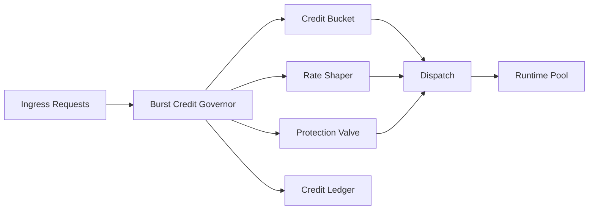

# Agent 突发额度治理器选型 FAQ（Cycle 1817）

## 1) 3 分钟结论
- **核心问题：** 平峰资源充足，但突发洪峰会瞬时打穿共享池并拖垮全局延迟。
- **推荐：** 租户突发额度（Burst Credit）+ 速率整形 + 熔断回落三段治理器。
- **目标：** 在可控预算内释放短时弹性，同时防止突发流量扩散为级联故障。

## 2) Q1 / Q2 / Q3
### Q1：为什么仅靠固定限流不够？
1) 固定限流会压制正常短峰，业务体验下降；
2) 热租户与冷租户共享阈值，公平性与效率两头受损；
3) 无额度账本时，异常峰值复盘困难。

### Q2：生产可落地的突发额度策略是什么？
- **额度桶**：为租户分配可恢复的 burst credit；
- **整形器**：按窗口平滑输出请求速率，避免瞬时尖峰；
- **保护阀**：超过预算即降级到保底通道或触发熔断；
- **账本**：记录额度消耗、恢复、抢占与拒绝事件。

### Q3：如何判断治理器有效？
- 突发期 P95/P99 延迟可控；
- 拒绝率与降级率在预算内；
- 关键租户 SLO 违约率下降。

## 3) 架构图

## 4) 选型矩阵
| 维度 | 固定限流 | Burst Credit 治理器（推荐） |
|---|---:|---:|
| 峰值弹性 | 低 | 高 |
| 全局稳定性 | 中 | 高 |
| 公平性治理 | 中 | 高 |
| 实施复杂度 | 低 | 中 |
| 审计可追溯 | 低 | 高 |

## 5) 证据与复算口径
- 证据文件：
  - `workshops/azure-agent-infra/evidence/cycle-1817-benchmark.json`
  - `workshops/azure-agent-infra/evidence/cycle-1817-latency.csv`
  - `workshops/azure-agent-infra/evidence/cycle-1817-throughput.csv`
  - `workshops/azure-agent-infra/evidence/cycle-1817-policy.csv`
- 标签：`measured / synthetic / anonymized_reported`。
- validation7：双语六段结构、7-card CSP 自包含、轮次/evidence 一致、链路可回放。

## 6) 生产检查清单
- [ ] 租户 burst credit 上限与恢复速率已配置。
- [ ] 速率整形窗口与保护阀阈值已联调。
- [ ] 降级/熔断路径可观测且可回放。
- [ ] 额度账本告警与审计查询可用。
- [ ] FAQ/H5/SVG/7-card 与 evidence 轮次一致。
