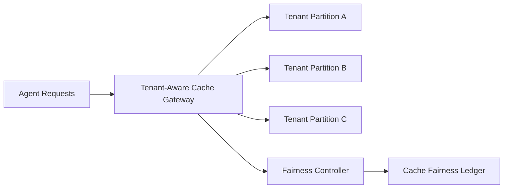

# Agent Cache Isolation and Tenant Fairness Selection FAQ (Cycle 1801)

## 1) Three-minute decision
- **Cache instability is usually not pure capacity shortage, but missing isolation boundaries and fairness controls.**
- **Recommendation:** tenant-isolated cache partitions + weighted quota fairness + progressive hotspot shedding.
- **Goal:** prevent hotspot tenants from consuming shared cache and stabilize global hit-rate/latency.

## 2) Core questions (Q1/Q2/Q3)
### Q1: Why does a shared cache drift?
1) bursty large tenants crowd out others,
2) long-tail tenants remain under-served,
3) hot-key migration amplifies jitter.

### Q2: What is a practical isolation/fairness design?
- layer 1: isolate cache namespaces by tenant/group,
- layer 2: allocate weighted cache budgets/caps,
- layer 3: shard hotspots with progressive eviction,
- monitoring: fairness signals feed alerts and auto-tuning.

### Q3: How to validate effectiveness?
- reduced inter-tenant hit-rate variance,
- stable P95 cache-read latency,
- bounded rejection/eviction jitter at peak.

## 3) Reference architecture

## 4) Decision matrix
| Dimension | Shared unisolated cache | Isolated + fairness control (Recommended) |
|---|---:|---:|
| Multi-tenant fairness | Low | High |
| Hit-rate stability | Medium | High |
| Peak resilience | Medium | High |
| Implementation complexity | Low | Medium |
| Observability | Medium | High |

## 5) Evidence and reproducibility
- Evidence files:
  - `workshops/azure-agent-infra/evidence/cycle-1801-benchmark.json`
  - `workshops/azure-agent-infra/evidence/cycle-1801-latency.csv`
  - `workshops/azure-agent-infra/evidence/cycle-1801-throughput.csv`
  - `workshops/azure-agent-infra/evidence/cycle-1801-policy.csv`
- Labels: `measured / synthetic / anonymized_reported`.
- validation7 requires bilingual structure fidelity, CSP self-contained cards, cycle-consistent evidence, and replayability checks.

## 6) Production checklist
- [ ] Cache-namespace isolation rules are active.
- [ ] Tenant quota weights/caps are dynamically tunable.
- [ ] Hotspot sharding/shedding is observable.
- [ ] Fairness metrics are wired into alert/rollback paths.
- [ ] FAQ/H5/SVG/7-card align with cycle evidence.
