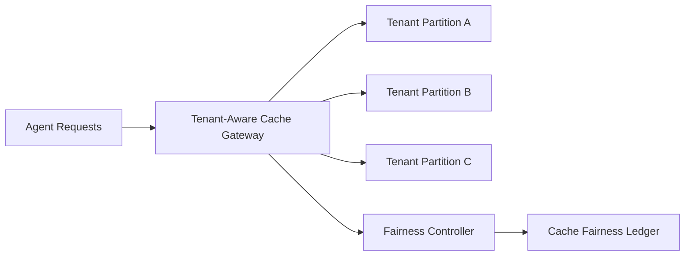

# Agent 缓存隔离与租户公平选型 FAQ（Cycle 1801）

## 1) 3 分钟结论
- **缓存失衡问题通常不是“容量不足”，而是“隔离边界和公平策略缺失”。**
- **推荐：** 租户隔离缓存分区 + 配额权重公平 + 热点逐级削峰。
- **目标：** 防止单租户热点吞噬共享缓存，稳定全局命中率与时延。

## 2) 关键问题（Q1/Q2/Q3）
### Q1：为什么共享缓存容易失衡？
1) 大租户突发挤占公共缓存；
2) 冷门租户命中率长期偏低；
3) 热点键迁移导致抖动放大。

### Q2：可落地的隔离公平策略？
- 一级：按租户或租户组隔离命名空间；
- 二级：基于权重分配缓存预算与上限；
- 三级：热点键启用分片与逐级淘汰；
- 监控：公平指标纳入告警与自动调参。

### Q3：如何验证策略有效？
- 租户间命中率方差下降；
- P95 缓存读取时延稳定；
- 高峰期拒绝率与驱逐抖动收敛。

## 3) 架构图

## 4) 选型矩阵
| 维度 | 共享无隔离缓存 | 隔离+公平控制（推荐） |
|---|---:|---:|
| 多租户公平性 | 低 | 高 |
| 命中率稳定性 | 中 | 高 |
| 峰值抗压能力 | 中 | 高 |
| 实施复杂度 | 低 | 中 |
| 可观测性 | 中 | 高 |

## 5) 证据与复算口径
- 证据文件：
  - `workshops/azure-agent-infra/evidence/cycle-1801-benchmark.json`
  - `workshops/azure-agent-infra/evidence/cycle-1801-latency.csv`
  - `workshops/azure-agent-infra/evidence/cycle-1801-throughput.csv`
  - `workshops/azure-agent-infra/evidence/cycle-1801-policy.csv`
- 标签：`measured / synthetic / anonymized_reported`。
- validation7：双语结构、CSP 自包含、证据轮次一致、可回放链路校验通过。

## 6) 生产检查清单
- [ ] 缓存命名空间隔离规则已生效。
- [ ] 租户配额权重与上限可动态调整。
- [ ] 热点键分片与削峰策略可观测。
- [ ] 公平性指标进入告警与回滚机制。
- [ ] FAQ/H5/SVG/7-card 与 evidence 轮次一致。
