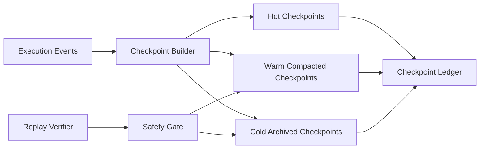

# Agent Checkpoint Compaction Safety Selection FAQ (Cycle 1821)

## 1) Three-minute decision
- **Core tension:** no checkpoint compaction causes sustained storage/replay cost growth, while over-compaction can lose critical traceability semantics.
- **Recommendation:** tiered checkpoints + safety-gated compaction + replay sampling verification.
- **Goal:** reduce storage cost while preserving incident forensics, auditability, and recovery integrity.

## 2) Q1 / Q2 / Q3
### Q1: Why is a single compression ratio unsafe in production?
1) tenant and workload traceability requirements differ,
2) sensitive paths need higher fidelity and blind compaction can damage evidence,
3) no risk-tiered policy introduces compliance gaps.

### Q2: What checkpoint compaction strategy is production-ready?
- **Hot checkpoints:** high-fidelity recent window for fast rollback,
- **Warm checkpoints:** structured compaction retaining critical state/index,
- **Cold checkpoints:** archived compaction with signed metadata,
- **Safety gate:** semantic integrity diff plus sampled replay validation before/after compaction.

### Q3: How do we prove “cost down without traceability loss”?
- lower storage cost per session,
- high sampled replay success rate,
- controlled audit query hit-rate and triage latency.

## 3) Reference architecture

## 4) Decision matrix
| Dimension | Keep-all no compaction | Tiered safe compaction (Recommended) |
|---|---:|---:|
| Storage cost | High | Medium-low |
| Replay reliability | High | High |
| Audit traceability | High | High |
| Implementation complexity | Low | Medium |
| Risk controllability | Medium | High |

## 5) Evidence and reproducibility
- Evidence files:
  - `workshops/azure-agent-infra/evidence/cycle-1821-benchmark.json`
  - `workshops/azure-agent-infra/evidence/cycle-1821-latency.csv`
  - `workshops/azure-agent-infra/evidence/cycle-1821-throughput.csv`
  - `workshops/azure-agent-infra/evidence/cycle-1821-policy.csv`
- Labels: `measured / synthetic / anonymized_reported`.
- validation7 enforces bilingual six-part structure, CSP self-contained 7-card output, strict cycle-evidence alignment, and replayability.

## 6) Production checklist
- [ ] Checkpoint tiering policy and retention windows are configured.
- [ ] Compaction gates (integrity diff + replay sampling) are integrated.
- [ ] Cold-archive signatures and audit metadata are verifiable.
- [ ] Replay-failure alerting and auto-fallback are operational.
- [ ] FAQ/H5/SVG/7-card align with cycle evidence.
