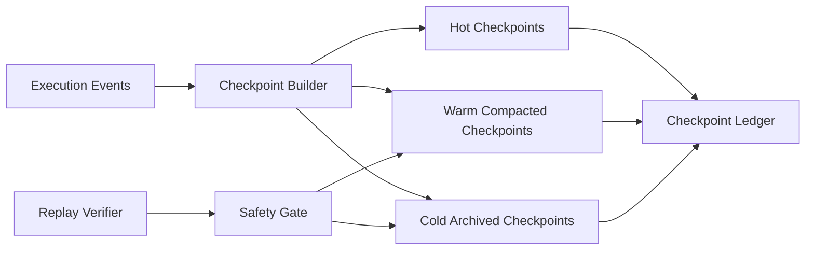

# Agent 检查点压缩安全选型 FAQ（Cycle 1821）

## 1) 3 分钟结论
- **核心矛盾：** 不做检查点压缩会导致存储与回放成本持续膨胀；压缩过度又可能丢失关键可追溯语义。
- **推荐：** 分层检查点 + 安全压缩门禁 + 可回放抽样校验。
- **目标：** 在控制存储成本的同时保持故障追踪、审计和恢复的完整性。

## 2) Q1 / Q2 / Q3
### Q1：为什么“统一压缩率”在生产上不可取？
1) 不同租户/任务的追溯要求差异大；
2) 敏感链路需要更高保真，盲目压缩会损坏证据；
3) 压缩策略无法按风险分级会引入合规漏洞。

### Q2：可落地的检查点压缩策略是什么？
- **热检查点**：最近窗口保持高保真，支持快速回滚；
- **温检查点**：结构化压缩，保留关键状态与索引；
- **冷检查点**：归档压缩并附带完整元数据与签名；
- **安全门禁**：压缩前后执行语义完整性对比与抽样回放验证。

### Q3：如何验证“降本不降可追溯”？
- 存储成本/会话下降；
- 抽样回放成功率维持高位；
- 审计查询命中率与定位时延可控。

## 3) 架构图

## 4) 选型矩阵
| 维度 | 无压缩保留 | 分层安全压缩（推荐） |
|---|---:|---:|
| 存储成本 | 高 | 中低 |
| 回放可靠性 | 高 | 高 |
| 审计可追溯 | 高 | 高 |
| 实施复杂度 | 低 | 中 |
| 风险可控性 | 中 | 高 |

## 5) 证据与复算口径
- 证据文件：
  - `workshops/azure-agent-infra/evidence/cycle-1821-benchmark.json`
  - `workshops/azure-agent-infra/evidence/cycle-1821-latency.csv`
  - `workshops/azure-agent-infra/evidence/cycle-1821-throughput.csv`
  - `workshops/azure-agent-infra/evidence/cycle-1821-policy.csv`
- 标签：`measured / synthetic / anonymized_reported`。
- validation7：双语六段结构、7-card CSP 自包含、轮次与 evidence 严格一致、可回放链路通过。

## 6) 生产检查清单
- [ ] 检查点分层策略与保留窗口已配置。
- [ ] 压缩门禁规则（完整性对比+抽样回放）已联调。
- [ ] 冷归档签名与审计元数据可验证。
- [ ] 回放失败告警与自动回退策略可用。
- [ ] FAQ/H5/SVG/7-card 与 evidence 轮次一致。
