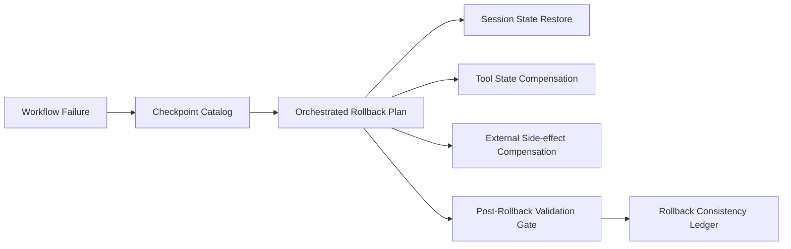

# Agent Checkpoint Rollback Consistency Selection FAQ (Cycle 1786)

## 1) Three-minute decision
- **The key risk in multi-step agent workflows is post-rollback inconsistency, not rollback invocation itself.**
- **Recommendation:** layered checkpoints (session/tool/external effects) + atomic rollback orchestration + post-rollback validation gates.
- **Goal:** make failure recovery predictable and replayable while preventing hidden state drift.

## 2) Core questions (Q1/Q2/Q3)
### Q1: Why generic transaction rollback is insufficient?
1) tool actions span multiple systems,
2) external side effects (messages/tickets/payments) are not naturally reversible,
3) session memory and execution state may diverge.

### Q2: What is the minimum viable consistency rollback model?
- layered checkpoints for session/tool/external receipts,
- dependency-reversed compensation orchestration,
- invariant validation gate before resuming execution.

### Q3: How to validate reliability?
- rollback success under injected faults,
- idempotent compensations with safe re-run,
- key metrics return to baseline bands post-rollback.

## 3) Reference architecture

## 4) Decision matrix
| Dimension | Single-layer rollback | Layered checkpoints + compensation orchestration (Recommended) |
|---|---:|---:|
| Consistency assurance | Low | High |
| Recovery predictability | Medium | High |
| External side-effect control | Low | High |
| Implementation complexity | Low | Medium-high |
| Audit replay quality | Medium | High |

## 5) Evidence and reproducibility
- Evidence files:
  - `workshops/azure-agent-infra/evidence/cycle-1786-benchmark.json`
  - `workshops/azure-agent-infra/evidence/cycle-1786-latency.csv`
  - `workshops/azure-agent-infra/evidence/cycle-1786-throughput.csv`
  - `workshops/azure-agent-infra/evidence/cycle-1786-policy.csv`
- Labels: `measured / synthetic / anonymized_reported`.
- validation7 requires bilingual structure, CSP self-contained cards, evidence consistency, and replayability trace.

## 6) Production checklist
- [ ] Checkpoint tiers and retention windows are explicit.
- [ ] Compensation actions are idempotent with retry policy.
- [ ] Post-rollback invariant gates are configurable.
- [ ] Rollback chain and outcomes are ledgered.
- [ ] FAQ/H5/SVG/7-card references are cycle-aligned.
