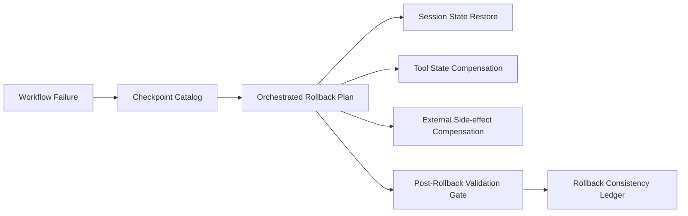

# Agent Checkpoint 回滚一致性选型 FAQ（Cycle 1786）

## 1) 3 分钟结论
- **多步骤 Agent 工作流的关键风险在于“回滚后状态不一致”，而不是回滚动作本身。**
- **推荐：** 检查点分层（会话/工具/外部副作用）+ 原子回滚编排 + 回滚后校验门禁。
- **目标：** 让失败恢复可预测、可回放，避免“看似回滚成功但数据已偏移”。

## 2) 关键问题（Q1/Q2/Q3）
### Q1：为什么普通事务回滚不够覆盖 Agent 场景？
1) 工具调用跨越多个系统边界；
2) 外部副作用（消息、工单、支付）无法天然回滚；
3) 会话记忆与执行状态可能不同步。

### Q2：一致性回滚的最小方案是什么？
- 分层检查点：记录会话状态、工具状态、外部操作凭证；
- 回滚编排：按依赖逆序执行补偿动作；
- 回滚校验：关键不变量不满足则阻断继续执行。

### Q3：如何验证回滚机制可靠？
- 故障注入下回滚成功率达标；
- 补偿动作幂等且可重复执行；
- 回滚后关键指标恢复至基线区间。

## 3) 架构图

## 4) 选型矩阵
| 维度 | 单层回滚 | 分层检查点+补偿编排（推荐） |
|---|---:|---:|
| 一致性保障 | 低 | 高 |
| 恢复可预测性 | 中 | 高 |
| 外部副作用控制 | 低 | 高 |
| 实施复杂度 | 低 | 中高 |
| 审计可回放 | 中 | 高 |

## 5) 证据与复算口径
- 证据文件：
  - `workshops/azure-agent-infra/evidence/cycle-1786-benchmark.json`
  - `workshops/azure-agent-infra/evidence/cycle-1786-latency.csv`
  - `workshops/azure-agent-infra/evidence/cycle-1786-throughput.csv`
  - `workshops/azure-agent-infra/evidence/cycle-1786-policy.csv`
- 标签：`measured / synthetic / anonymized_reported`。
- validation7：双语结构、CSP、证据一致、可回放链路全部通过。

## 6) 生产检查清单
- [ ] 检查点层级定义与保留周期明确。
- [ ] 补偿动作具备幂等与重试策略。
- [ ] 回滚后不变量校验门禁可配置。
- [ ] 回滚链路与结果写入审计账本。
- [ ] FAQ/H5/SVG/7-card 与 evidence 轮次一致。
