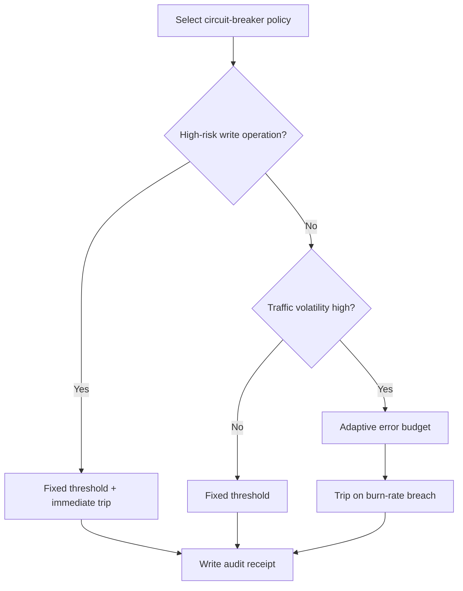
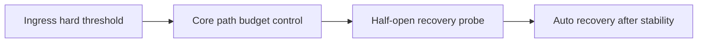
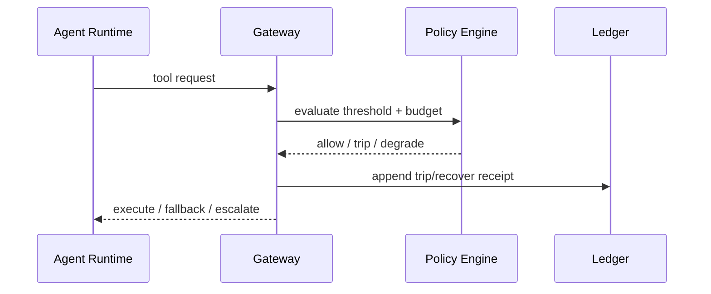

# Agent Circuit Breaker Budget Strategy FAQ (Fixed Failure Threshold vs Adaptive Error Budget)

> Scope lock: this document only covers **circuit-breaker policy selection for agent tool orchestration**, not model routing or identity injection design.

## 📌 Core takeaways (3 bullets)

1. **For high-risk write paths, default to fixed threshold + immediate trip**: fail fast is safer than allowing cascading corruption.  
2. **For bursty traffic, prefer adaptive error budget**: first-principles view is to govern the *rate of reliability burn* instead of raw failure count.  
3. **Production baseline should be layered**: hard threshold at ingress, adaptive budget in core chains, and immutable trip/recover receipts.

## 🎯 Q1: What is the real difference between fixed threshold and adaptive budget?

- **Plain language**: fixed threshold is a fuse; adaptive budget is a battery meter.  
- **First principle**: both patterns limit blast radius, but they regulate different variables: absolute failure ratio vs failure-burn velocity.

## 🎯 Q2: When should each strategy be selected?

- **Fixed threshold first**: payment write operations, privilege changes, cross-tenant sensitive actions.  
- **Adaptive budget first**: high-concurrency read paths, burst-driven workloads, retry-friendly downstreams.  
- **Hybrid policy**: hard trip at ingress + burn-rate control inside + graded fallback (rate-limit / read-only / human escalation).

## 🎯 Q3: How should this be implemented for MCP/A2A production orchestration?

- **Plain language**: add a hard brake, then a smart brake, then log every brake event.  
- **First principle**: autonomous policy is only production-safe when decisions are explainable, replayable, and auditable.  
- **Path**: request enters gateway -> fixed-threshold check -> budget burn-rate check -> trip/half-open/recover -> MCP/A2A audit ledger receipt.

## 🧭 Mermaid (TD decision tree + LR path + sequence)

## 📊 Architect decision matrix

| Dimension | Fixed failure threshold | Adaptive error budget | Layered hybrid (recommended) |
|---|---|---|---|
| Failure stop speed | Very high | Medium | High |
| False-positive risk under spikes | Higher | Lower | Low |
| Tuning complexity | Low | Medium-high | Medium |
| Multi-tenant operability | Medium | High | High |
| Best-fit workload | High-risk write paths | Bursty read paths | Mixed SaaS production chains |

## 🧪 Quant example + 7-card 4:5 insights

| Metric | Fixed-threshold baseline | Layered-budget baseline |
|---|---:|---:|
| Cold start/restore P50 (ms) | 99 | 102 |
| Cold start/restore P95 (ms) | 158 | 166 |
| Throughput P50 (rps) | 1680 | 1590 |
| Policy interception rate | 95.5% | 97.1% |
| Cost per session (USD/20min) | 0.00483 | 0.00506 |

- 7-card output: `benchmark-cards.html` / `benchmark-cards.en.html`  
- Evidence pack: `evidence/cycle-412-benchmark.json`, `evidence/cycle-412-sources.json`  
- Labeling: `measured / synthetic / anonymized_reported` (production gaps explicitly marked as `not_measured`)

## 🛠️ Production verification checklist

- [ ] Define fixed-threshold trip conditions (error rate, consecutive failures, window length)
- [ ] Define burn-rate policies (short/long windows) and fallback ladder
- [ ] Emit unified trip/recover events from APIM/Envoy/policy engine
- [ ] Persist replayable MCP/A2A evidence with policy version and decision reason
- [ ] Keep all 7-card coordinates evidence-backed; mark missing production points as `not_measured`
