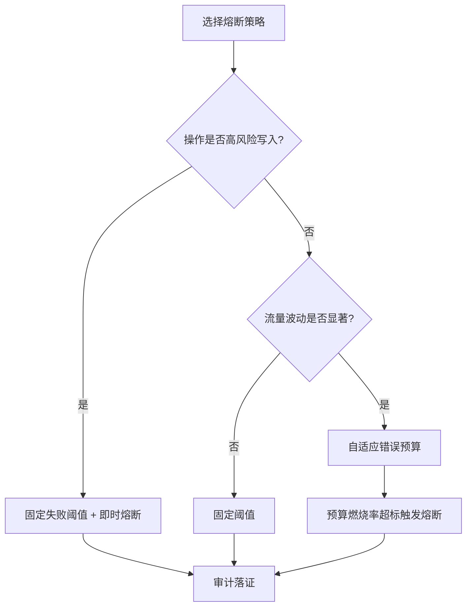
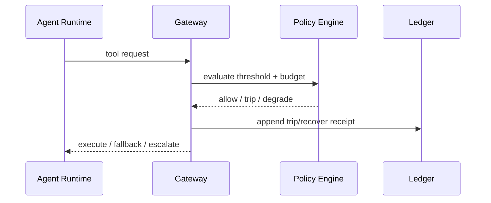

# Agent 状态熔断预算策略选型 FAQ（固定失败阈值 vs 自适应错误预算）

> 专题边界：仅讨论 **Agent 工具链/编排链路** 的熔断策略，不扩展到模型选型与身份注入。

## 📌 核心结论速览（3 条）

1. **高风险默认“固定阈值 + 立即熔断”**：大白话就是“宁可快停，也别带病放大事故”。  
2. **高波动流量优先“自适应错误预算”**：第一性原理是把“失败速率”映射成“可用性预算消耗速度”，避免偶发尖峰触发误杀。  
3. **生产推荐分层组合**：入口固定阈值兜底，核心链路叠加自适应预算，并把每次 trip/recover 写入审计证据链。

## 🎯 Q1：固定失败阈值和自适应错误预算的本质区别是什么？

- **大白话**：固定阈值像“保险丝”，到点就断；自适应预算像“电池百分比”，耗得太快才断。  
- **第一性原理**：熔断是为了限制故障传播半径。固定阈值控制的是“绝对失败次数/比例”，自适应预算控制的是“失败速度对可用性的侵蚀率”。

## 🎯 Q2：什么时候选固定阈值？什么时候选自适应预算？

- **固定阈值优先**：金融扣款、权限写操作、跨租户敏感调用（容错空间接近零）。  
- **自适应预算优先**：高并发读场景、突发流量、下游抖动频繁但可重试的工具链。  
- **混合策略**：入口硬阈值 + 内层预算消耗监控 + 分级降级（限流/只读/转人工）。

## 🎯 Q3：怎么在 MCP/A2A 生产编排里落地？

- **大白话**：先设“硬刹车”，再加“智能刹车”，最后把刹车记录写清楚。  
- **第一性原理**：任何自动策略都必须可解释、可回放、可审计，否则无法在多租户与合规环境长期运行。  
- **落地链路**：请求进入网关 -> 固定阈值判定 -> 错误预算燃烧率计算 -> 熔断/半开/恢复 -> MCP/A2A 审计账本落证。

## 🧭 Mermaid（决策树 TD + 路径 LR + 时序）

## 📊 架构师决策矩阵

| 维度 | 固定失败阈值 | 自适应错误预算 | 分层组合（推荐） |
|---|---|---|---|
| 故障阻断速度 | 极快 | 中 | 快 |
| 误杀概率（流量尖峰） | 较高 | 较低 | 低 |
| 调参复杂度 | 低 | 中高 | 中 |
| 多租户可运营性 | 中 | 高 | 高 |
| 适配场景 | 高风险写路径 | 高波动读路径 | SaaS 生产混合场景 |

## 🧪 定量算例 + 7-Card 4:5 洞察

| 指标 | 固定阈值基线 | 分层预算基线 |
|---|---:|---:|
| 冷启动/恢复 P50 (ms) | 99 | 102 |
| 冷启动/恢复 P95 (ms) | 158 | 166 |
| 并发吞吐 P50 (rps) | 1680 | 1590 |
| 策略拦截率 | 95.5% | 97.1% |
| 单会话成本 (USD/20min) | 0.00483 | 0.00506 |

- 7-card 输出：`benchmark-cards.html` / `benchmark-cards.en.html`  
- 证据包：`evidence/cycle-412-benchmark.json`、`evidence/cycle-412-sources.json`  
- 标签：`measured / synthetic / anonymized_reported`（生产未跑指标统一标注 `not_measured`）

## 🛠️ 生产核验 Checklist

- [ ] 定义固定阈值 trip 条件（失败率、连续失败数、窗口长度）
- [ ] 定义预算燃烧率（短窗/长窗）和升级规则（限流、只读、人工接管）
- [ ] 在 APIM/Envoy/Policy Engine 统一输出 trip/recover 事件
- [ ] MCP/A2A 全链路写入可回放审计证据（含策略版本与判定理由）
- [ ] 7-card 全部坐标来自封存数据；缺失项显式标 `not_measured`
