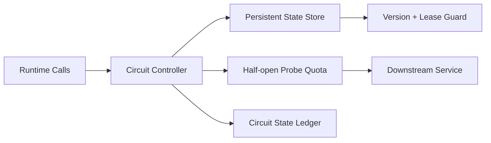

# Agent Circuit State Persistence Selection FAQ (Cycle 1808)

## 1) Three-minute decision
- **Circuit mis-recovery usually comes from state loss across restart/migration, not just bad thresholds.**
- **Recommendation:** persistent circuit state + versioned leases + quota-controlled half-open probes.
- **Goal:** avoid repeated open/close oscillation during incidents and stabilize recovery pressure.

## 2) Q1 / Q2 / Q3
### Q1: Why is in-memory-only circuit state risky?
1) state resets on process restart,
2) multi-node state diverges,
3) half-open traffic multiplies across replicas.

### Q2: What persistence approach is practical?
- store circuit state in low-latency shared state backend,
- use version + lease guards for concurrent writers,
- enforce global probe quota in half-open phase,
- ramp traffic gradually after cool-down.

### Q3: How to validate effectiveness?
- fewer circuit oscillation events,
- smoother recovery curve,
- reduced downstream error spikes and retry storms.

## 3) Reference architecture

## 4) Decision matrix
| Dimension | In-memory circuit | Persistent circuit (Recommended) |
|---|---:|---:|
| Continuity after restart | Low | High |
| Multi-node consistency | Low | High |
| Recovery stability | Medium | High |
| Implementation complexity | Low | Medium |
| Audit explainability | Medium | High |

## 5) Evidence and reproducibility
- Evidence files:
  - `workshops/azure-agent-infra/evidence/cycle-1808-benchmark.json`
  - `workshops/azure-agent-infra/evidence/cycle-1808-latency.csv`
  - `workshops/azure-agent-infra/evidence/cycle-1808-throughput.csv`
  - `workshops/azure-agent-infra/evidence/cycle-1808-policy.csv`
- Labels: `measured / synthetic / anonymized_reported`.
- validation7 requires bilingual structure fidelity, CSP self-contained cards, cycle-consistent evidence, and replayability checks.

## 6) Production checklist
- [ ] Circuit state read/write path is highly available.
- [ ] Version+lease guard prevents concurrent overwrite.
- [ ] Half-open probes are globally quota-limited.
- [ ] Cool-down and gradual ramp policies are configurable.
- [ ] FAQ/H5/SVG/7-card align with cycle evidence.
