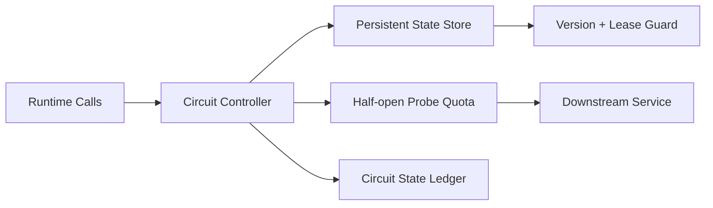

# Agent 熔断状态持久化选型 FAQ（Cycle 1808）

## 1) 3 分钟结论
- **熔断误恢复问题通常不是阈值错，而是状态在重启/迁移时丢失。**
- **推荐：** 熔断状态持久化 + 版本化租约 + 半开探测配额控制。
- **目标：** 避免故障期间反复开合震荡，稳定恢复路径与下游压力。

## 2) Q1 / Q2 / Q3
### Q1：为什么内存态熔断器风险高？
1) 进程重启后状态清零；
2) 横向扩展节点状态不一致；
3) 半开流量在多节点放大。

### Q2：可落地持久化方案？
- 将熔断状态写入低延迟共享状态存储；
- 使用版本号与租约避免并发覆盖；
- 半开阶段按全局配额放行探测请求；
- 恢复后按冷却窗口逐步放量。

### Q3：如何验证策略有效？
- 熔断抖动次数下降；
- 故障恢复曲线更平滑；
- 下游错误峰值和重试风暴收敛。

## 3) 架构图

## 4) 选型矩阵
| 维度 | 内存态熔断 | 持久化熔断（推荐） |
|---|---:|---:|
| 重启后连续性 | 低 | 高 |
| 多节点一致性 | 低 | 高 |
| 恢复稳定性 | 中 | 高 |
| 实施复杂度 | 低 | 中 |
| 审计可解释性 | 中 | 高 |

## 5) 证据与复算口径
- 证据文件：
  - `workshops/azure-agent-infra/evidence/cycle-1808-benchmark.json`
  - `workshops/azure-agent-infra/evidence/cycle-1808-latency.csv`
  - `workshops/azure-agent-infra/evidence/cycle-1808-throughput.csv`
  - `workshops/azure-agent-infra/evidence/cycle-1808-policy.csv`
- 标签：`measured / synthetic / anonymized_reported`。
- validation7：双语结构、CSP 自包含、证据轮次一致、可回放链路校验通过。

## 6) 生产检查清单
- [ ] 熔断状态读写链路具备高可用。
- [ ] 版本租约防并发覆盖已启用。
- [ ] 半开探测配额按全局限流执行。
- [ ] 冷却窗口与逐步放量策略可配置。
- [ ] FAQ/H5/SVG/7-card 与 evidence 轮次一致。
