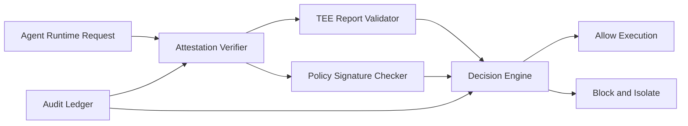

# Confidential Compute Attestation Selection FAQ (Cycle 1846)

## 1) Three-minute decision
- **Core tradeoff:** agent runtimes need strong isolation and provable trust, but heavy attestation chains can add startup latency and operational overhead.
- **Recommendation:** tiered attestation (strong boot attestation plus runtime sampling), signed policies, and hard deny for untrusted execution.
- **Goal:** deliver auditable zero-trust execution evidence within acceptable latency budgets.

## 2) Q1 / Q2 / Q3
### Q1: Why is image-signature validation alone insufficient?
1) image signatures do not prove host/runtime/kernel state,
2) control/data paths can still be tampered by intermediate layers,
3) no remote attestation weakens compliance-grade verification.

### Q2: What production-ready remote attestation architecture should be used?
- **Strong boot attestation:** validate TEE report and policy hash at start,
- **Runtime sampling:** periodic attestation refresh for drift detection,
- **Signed policy:** versioned and signed attestation decision policy,
- **Deny path:** hard block and isolate instances that fail attestation.

### Q3: How do we validate trusted availability?
- attestation pass rate and false-deny rate stay within targets,
- incremental cold-start overhead stays bounded,
- audit trails map policy version, report digest, and runtime instance.

## 3) Reference architecture

## 4) Decision matrix
| Dimension | Image signature only | Boot + runtime remote attestation (Recommended) |
|---|---:|---:|
| Trusted-execution strength | Low | High |
| Audit verifiability | Low | High |
| Startup latency impact | Better | Medium |
| Ops complexity | Low | Medium-high |
| Compliance readiness | Low | High |

## 5) Evidence and reproducibility
- Evidence files:
  - `workshops/azure-agent-infra/evidence/cycle-1846-benchmark.json`
  - `workshops/azure-agent-infra/evidence/cycle-1846-latency.csv`
  - `workshops/azure-agent-infra/evidence/cycle-1846-throughput.csv`
  - `workshops/azure-agent-infra/evidence/cycle-1846-policy.csv`
- Labels: `measured / synthetic / anonymized_reported`.
- validation7 enforces bilingual six-part structure, CSP self-contained 7-card output, strict cycle-evidence alignment, and replayability.

## 6) Production checklist
- [ ] Boot-time attestation and deny policy are active.
- [ ] Runtime sampling covers critical instances.
- [ ] Policy-signature version lineage is auditable.
- [ ] Failed-attestation isolation path is replay-validated.
- [ ] FAQ/H5/SVG/7-card align with cycle evidence.
