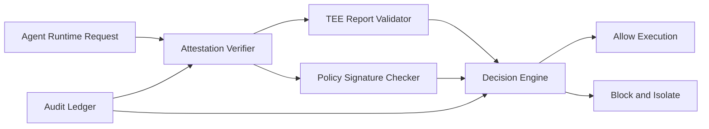

# Confidential Compute 远程证明选型 FAQ（Cycle 1846）

## 1) 3 分钟结论
- **核心矛盾：** Agent 执行面需要高隔离与可证明可信，但证明链太重会增加启动时延与运维复杂度。
- **推荐：** 证明策略分级（启动强证明 + 运行时抽检）+ 策略签名 + 拒绝未证明执行。
- **目标：** 在可接受延迟下提供可审计的零信任执行证据。

## 2) Q1 / Q2 / Q3
### Q1：为什么“只看镜像签名”不足以建立执行信任？
1) 镜像签名不能证明运行时宿主与内核状态；
2) 控制面与数据面路径可能被中间层篡改；
3) 无远程证明会削弱合规审计的可验证性。

### Q2：生产级远程证明架构怎么落地？
- **启动强证明：** 实例启动时校验 TEE 报告与策略哈希；
- **运行时抽检：** 周期性证明刷新，检测配置漂移；
- **策略签名：** 证明判定策略版本化并签名；
- **拒绝策略：** 对未通过证明实例执行硬拒绝与隔离。

### Q3：如何验证“可信且可用”？
- 证明通过率与误拒率在目标区间；
- 证明引入的冷启动增量可控；
- 审计链可追溯到策略版本、报告摘要与执行实例。

## 3) 架构图

## 4) 选型矩阵
| 维度 | 仅镜像签名校验 | 启动+运行时远程证明（推荐） |
|---|---:|---:|
| 可信执行强度 | 低 | 高 |
| 审计可验证性 | 低 | 高 |
| 启动时延 | 高优 | 中 |
| 运维复杂度 | 低 | 中高 |
| 合规适配 | 低 | 高 |

## 5) 证据与复算口径
- 证据文件：
  - `workshops/azure-agent-infra/evidence/cycle-1846-benchmark.json`
  - `workshops/azure-agent-infra/evidence/cycle-1846-latency.csv`
  - `workshops/azure-agent-infra/evidence/cycle-1846-throughput.csv`
  - `workshops/azure-agent-infra/evidence/cycle-1846-policy.csv`
- 标签：`measured / synthetic / anonymized_reported`。
- validation7：双语六段结构、7-card CSP 自包含、轮次与 evidence 一致、可回放链路通过。

## 6) 生产检查清单
- [ ] 启动强证明策略与拒绝规则生效。
- [ ] 运行时抽检计划覆盖关键实例。
- [ ] 策略签名与版本追踪可审计。
- [ ] 未通过证明实例隔离路径可回放。
- [ ] FAQ/H5/SVG/7-card 与 evidence 轮次一致。
